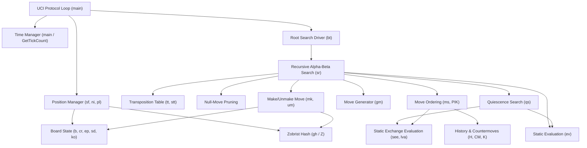
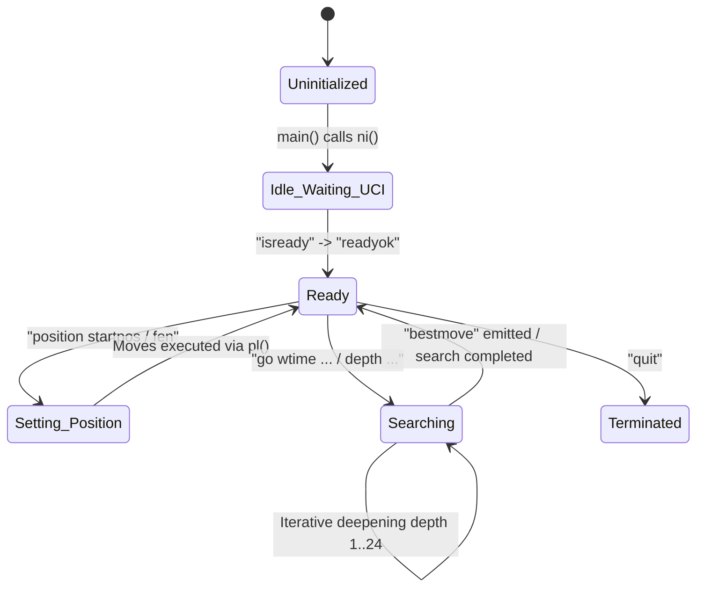
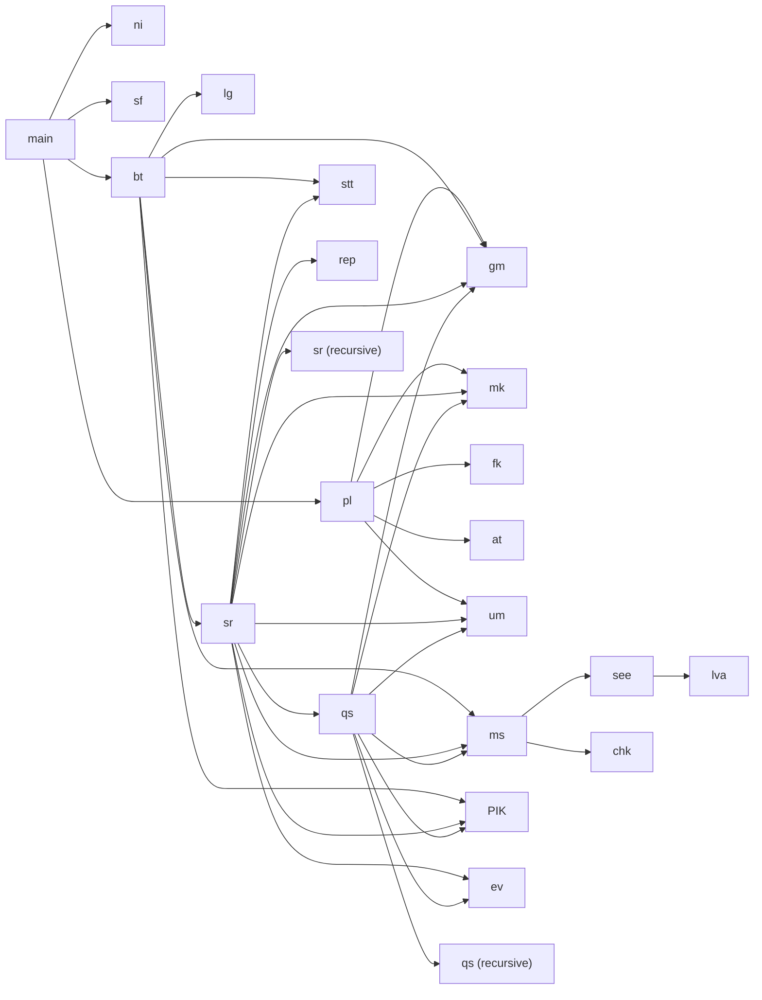
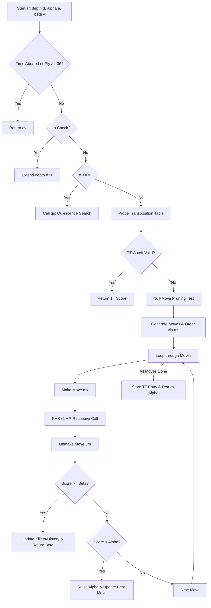

# Mite Chess Engine — Technical Architecture & Implementation Notes

An exhaustive, line-by-line engineering specification and architectural breakdown of the **Mite** chess engine source code (`src/Mite.c`), authored by Viraj Ravani.

---

## 1. Introduction

### 1.1 Overview and Purpose
**Mite** is a high-performance, minimalist **~2000 Elo**, **UCI-compliant** chess engine implemented in ANSI C. Written in approximately 409 lines of highly condensed, branch-optimized C code spanning **under 20 KB** (< 19.7 KB) of source text (`src/Mite.c`) and compiling to a standalone executable of only **~115 KB** (`bin/Mite.exe`), Mite is engineered to deliver competitive tournament-caliber chess play (demonstrated by competitive match results against Stockfish 2000 Elo, TSCP, and Fairy-Max) while maintaining an ultra-compact binary footprint and zero external library dependencies.

#### Key Engine Specifications
| Attribute | Specification | Details |
| :--- | :--- | :--- |
| **Playing Strength** | **~2000 Elo** | Benchmarked against Stockfish 2000 Elo (60.3% win rate across 600 games), TSCP (88.0%), and Fairy-Max (67.5%) |
| **Source Code Footprint** | **< 19.7 KB** | Single monolithic C source file (`src/Mite.c`), ~409 lines of condensed, branch-optimized ANSI C |
| **Compiled Binary Size** | **~115 KB** | Standalone static executable (`bin/Mite.exe`) with zero dynamic runtime DLL dependencies |
| **Protocol Compatibility** | **UCI Standard** | Universal Chess Interface compliant (compatible with Arena, Cutechess, Fritz, BanksiaGUI, etc.) |
| **Board Representation** | **0x88 Hexadecimal** | 128-byte array with fast $O(1)$ off-board detection and square-difference lookup tables |
| **Transposition Memory** | **16 MB default** | $2^{20}$ Transposition Table entries (16 bytes each), zero dynamic memory allocations during search |
| **Platform Target** | **Windows & POSIX** | Dual-platform timing support via Win32 `GetTickCount()` and POSIX `clock_gettime()` |

The engine implements the complete Universal Chess Interface (UCI) protocol specification, allowing seamless integration with modern chess graphical user interfaces (such as Arena, Cutechess, BanksiaGUI, and Fritz) as well as automated match runners. Despite its compact footprint, Mite incorporates advanced search and evaluation techniques found in elite contemporary chess software, including:
- Iterative deepening with dynamic aspiration windowing
- Principal Variation Search (PVS) with negamax formulation
- Comprehensive quiescence search with Static Exchange Evaluation (SEE) pruning
- Null-Move Pruning (NMP) with mate threat detection
- Multi-tier Late Move Reductions (LMR) and Late Move Pruning (LMP)
- Reverse futility pruning and razoring
- Two-tier killer move heuristics and countermove tables
- Depth-squared history heuristics with butterfly malus penalties
- Transposition table (16 MB default) with Zobrist hashing, 64-bit key verification, aging, and mate-distance score normalization
- Rich, handcrafted evaluation function covering material imbalance, piece-square tables, pawn structure, rook open files, king safety, knight outposts, bishop pair, and specialized endgame driving heuristics

### 1.2 Design Goals and Philosophy
The design of Mite balances three competing engineering imperatives:
1. **Extreme Compactness**: All logic—board representation, move generation, evaluation, search, hash table, and UCI parser—is concentrated into a single monolithic compilation unit (`src/Mite.c`) under 19.7 KB in source size, compiling into an ultra-lean ~115 KB standalone executable. This demonstrates how low-level systems programming and careful data flow design can pack sophisticated algorithms into minimal binary and source volume without relying on bloated libraries.
2. **Playing Strength (~2000 Elo)**: Unlike toy engines or simple 100-line educational scripts that play at 1200–1400 Elo, Mite is engineered to compete effectively at the ~2000 Elo tier, scoring winning records against Stockfish at 2000 Elo limit, TSCP, and Fairy-Max across extensive testing (78.5% aggregate score across 2,600 tournament games).
3. **Execution Efficiency & Latency Control**: The engine is optimized for cache-friendly memory access, branch predictability, and microsecond-level move latency. State transitions are governed by incremental Zobrist hashing and 0x88 board operations with zero dynamic memory allocation (`malloc`/`free`) during search.

### 1.3 Source Code Organization
The repository is structured as follows:
- `src/Mite.c`: The complete engine source code. All global arrays, macros, type definitions, and functions reside here.
- `bin/`: Precompiled static executable binaries (`Mite.exe`).
- `benchmarks/`: Complete match PGN archives across reference tournaments and benchmark reports (`overview.md`).
- `Makefile`: Portable build automation script for GCC/MinGW on Windows and POSIX.
- `README.md`: Project overview, features, benchmarks, and quick start guide.
- `SETUP.md`: Step-by-step setup, compilation, and automated match testing manual.
- `LICENSE`: Open-source MIT License terms and permissions.
- `CONTRIBUTING.md`: Guidelines for community contributions, issue reporting, and code quality expectations.
- `SECURITY.md`: Vulnerability reporting policies and version maintenance commitments.
- `DISCLAIMER.md`: Legal disclaimers, trademark attributions, and "as-is" software liability boundaries.
- `ENGINE_NOTES.md`: This comprehensive technical manual.

### 1.4 Intended Audience and How to Use This Document
This document is designed for:
- **Chess Engine Developers**: Looking to understand how modern search heuristics (LMR, PVS, SEE, killers, history, aspiration windows) can be implemented in a compact codebase.
- **Systems & Performance Engineers**: Studying low-level C data structures, bitwise arithmetic, 0x88 board coordinates, and cache-conscious memory layouts.
- **Maintainers & Contributors**: Who need a comprehensive reverse-engineered reference to navigate Mite's condensed variable names, compact macros, and dense algorithmic loops.

### 1.5 Scope and Documentation Conventions
- **Identifiers**: Every identifier (e.g., `b`, `sd`, `cr`, `ep`, `mk`, `um`, `sr`, `qs`, `ev`) is documented using its exact name as defined in `src/Mite.c`.
- **Coordinates**: Board squares are represented in 0x88 hexadecimal indexing (`0x00` = a1, `0x77` = h8) unless explicitly converted to algebraic format (`a1`–`h8`) or 0..63 dense indexing.
- **Perspective**: Unless otherwise noted, internal search and evaluation scores are computed from the perspective of the side to move (`sd`).

---

## 2. Table of Contents & Navigable Indexes

### Table of Contents
1. [Introduction](#1-introduction)
   - [1.1 Overview and Purpose](#11-overview-and-purpose)
   - [1.2 Design Goals and Philosophy](#12-design-goals-and-philosophy)
   - [1.3 Source Code Organization](#13-source-code-organization)
   - [1.4 Intended Audience](#14-intended-audience-and-how-to-use-this-document)
   - [1.5 Scope and Documentation Conventions](#15-scope-and-documentation-conventions)
2. [Table of Contents & Navigable Indexes](#2-table-of-contents--navigable-indexes)
   - [Function Index](#function-index)
   - [Variable & State Index](#variable--state-index)
   - [Constants & Macros Index](#constants--macros-index)
   - [Feature Implementation Matrix](#feature-implementation-matrix)
   - [UCI Command Reference Index](#uci-command-reference-index)
   - [Diagrams & Visualizations Index](#diagrams--visualizations-index)
3. [Architecture and Execution Flow](#3-architecture-and-execution-flow)
   - [3.1 High-Level Architecture](#31-high-level-architecture)
   - [3.2 Component Relationship Diagram](#32-component-relationship-diagram)
   - [3.3 Engine Lifecycle & State Machine](#33-engine-lifecycle--state-machine)
   - [3.4 Function Call Hierarchy](#34-function-call-hierarchy)
   - [3.5 Search and Evaluation Data Flow](#35-search-and-evaluation-data-flow)
4. [Complete Variable Reference](#4-complete-variable-reference)
   - [4.1 Global Board & Position Variables](#41-global-board--position-variables)
   - [4.2 Search Control & Timing Variables](#42-search-control--timing-variables)
   - [4.3 Transposition Table & Hash Variables](#43-transposition-table--hash-variables)
   - [4.4 Heuristic & Move-Ordering Arrays](#44-heuristic--move-ordering-arrays)
   - [4.5 Evaluation Arrays & Tuning Tables](#45-evaluation-arrays--tuning-tables)
   - [4.6 Master Variable Reference Table](#46-master-variable-reference-table)
5. [Data Structures and Board Representation](#5-data-structures-and-board-representation)
   - [5.1 The 0x88 Board Coordinate System](#51-the-0x88-board-coordinate-system)
   - [5.2 Piece Encoding & Mathematical Properties](#52-piece-encoding--mathematical-properties)
   - [5.3 Dense 64-Square Coordinate Mapping](#53-dense-64-square-coordinate-mapping)
   - [5.4 Move Structure (struct M)](#54-move-structure-struct-m)
   - [5.5 Transposition Table Entry (struct TT)](#55-transposition-table-entry-struct-tt)
   - [5.6 Zobrist Hashing Architecture](#56-zobrist-hashing-architecture)
   - [5.7 Repetition and 50-Move Tracking](#57-repetition-and-50-move-tracking)
6. [Complete Function Reference](#6-complete-function-reference)
   - [6.1 GetTickCount](#61-gettickcount)
   - [6.2 s2](#62-s2)
   - [6.3 ms2](#63-ms2)
   - [6.4 gh](#64-gh)
   - [6.5 mk](#65-mk)
   - [6.6 um](#66-um)
   - [6.7 ni](#67-ni)
   - [6.8 sf](#68-sf)
   - [6.9 at](#69-at)
   - [6.10 lg](#610-lg)
   - [6.11 lva](#611-lva)
   - [6.12 see](#612-see)
   - [6.13 chk](#613-chk)
   - [6.14 gm](#614-gm)
   - [6.15 ms](#615-ms)
   - [6.16 ev](#616-ev)
   - [6.17 qs](#617-qs)
   - [6.18 stt](#618-stt)
   - [6.19 rep](#619-rep)
   - [6.20 sr](#620-sr)
   - [6.21 bt](#621-bt)
   - [6.22 pl](#622-pl)
   - [6.23 main](#623-main)
7. [Constants and Configuration](#7-constants-and-configuration)
   - [7.1 Numerical Limits and Bounds](#71-numerical-limits-and-bounds)
   - [7.2 Piece Value Constants](#72-piece-value-constants)
   - [7.3 Macro Definitions & Functional Expansions](#73-macro-definitions--functional-expansions)
   - [7.4 Ray and Offset Vectors](#74-ray-and-offset-vectors)
8. [Move Generation and Chess Rules](#8-move-generation-and-chess-rules)
   - [8.1 Pseudolegal Move Generation](#81-pseudolegal-move-generation)
   - [8.2 Pawn Mechanics, Promotions, and En Passant](#82-pawn-mechanics-promotions-and-en-passant)
   - [8.3 Sliding and Leaping Piece Movements](#83-sliding-and-leaping-piece-movements)
   - [8.4 Castling Rules & Path Validation](#84-castling-rules--path-validation)
   - [8.5 Check Detection and King Tracking](#85-check-detection-and-king-tracking)
   - [8.6 Draw Rules: Repetition, 50-Move, Insufficient Material](#86-draw-rules-repetition-50-move-insufficient-material)
9. [Position Evaluation](#9-position-evaluation)
   - [9.1 Evaluation Overview & Phase Calculation](#91-evaluation-overview--phase-calculation)
   - [9.2 Piece-Square Tables (PST) & Compression Scheme](#92-piece-square-tables-pst--compression-scheme)
   - [9.3 Material Balance and Piece Pairs](#93-material-balance-and-piece-pairs)
   - [9.4 Pawn Structure Evaluation](#94-pawn-structure-evaluation)
   - [9.5 Piece Activity, Outposts, and Mobility](#95-piece-activity-outposts-and-mobility)
   - [9.6 King Safety, Pawn Shields, and Virtual King Attacks](#96-king-safety-pawn-shields-and-virtual-king-attacks)
   - [9.7 Endgame Adjustments and Corner Driving](#97-endgame-adjustments-and-corner-driving)
   - [9.8 Tempo and Output Perspective](#98-tempo-and-output-perspective)
10. [Search Algorithm — Detailed Explanation](#10-search-algorithm--detailed-explanation)
    - [10.1 Negamax Framework & Alpha-Beta Foundations](#101-negamax-framework--alpha-beta-foundations)
    - [10.2 Iterative Deepening & Aspiration Windows](#102-iterative-deepening--aspiration-windows)
    - [10.3 Principal Variation Search (PVS)](#103-principal-variation-search-pvs)
    - [10.4 Quiescence Search (QS)](#104-quiescence-search-qs)
    - [10.5 Static Exchange Evaluation (SEE)](#105-static-exchange-evaluation-see)
    - [10.6 Null-Move Pruning (NMP) & Verification](#106-null-move-pruning-nmp--verification)
    - [10.7 Reverse Futility Pruning & Razoring](#107-reverse-futility-pruning--razoring)
    - [10.8 Late Move Reductions (LMR) & Late Move Pruning (LMP)](#108-late-move-reductions-lmr--late-move-pruning-lmp)
    - [10.9 Move Ordering Architecture](#109-move-ordering-architecture)
    - [10.10 Killer Moves, Countermoves, and History Heuristics](#1010-killer-moves-countermoves-and-history-heuristics)
    - [10.11 Mate Score Handling & Horizon Corrections](#1011-mate-score-handling--horizon-corrections)
11. [Transposition Table and Hashing](#11-transposition-table-and-hashing)
    - [11.1 Zobrist Hashing Implementation](#111-zobrist-hashing-implementation)
    - [11.2 Table Organization & Entry Layout](#112-table-organization--entry-layout)
    - [11.3 Probing, Bound Types, and Score Normalization](#113-probing-bound-types-and-score-normalization)
    - [11.4 Replacement Strategy & Generation Aging](#114-replacement-strategy--generation-aging)
12. [Time Management and Performance](#12-time-management-and-performance)
    - [12.1 Dynamic Clock Allocation](#121-dynamic-clock-allocation)
    - [12.2 Search Abort Mechanism](#122-search-abort-mechanism)
    - [12.3 Node Counter & NPS Estimation](#123-node-counter--nps-estimation)
    - [12.4 Complexity & Memory Profile](#124-complexity--memory-profile)
13. [UCI Protocol and Input Parsing](#13-uci-protocol-and-input-parsing)
    - [13.1 Protocol Handshake & Information Strings](#131-protocol-handshake--information-strings)
    - [13.2 Position Setup (`position startpos` / `fen`)](#132-position-setup-position-startpos--fen)
    - [13.3 Search Invocation (`go`) & Time Parsing](#133-search-invocation-go--time-parsing)
    - [13.4 Search Control & Termination (`stop` / `quit`)](#134-search-control--termination-stop--quit)
    - [13.5 Protocol Output Specifications](#135-protocol-output-specifications)
14. [End-to-End Execution Traces](#14-end-to-end-execution-traces)
    - [14.1 Startup and UCI Initialization](#141-startup-and-uci-initialization)
    - [14.2 Position Loading & Move Sequence Processing](#142-position-loading--move-sequence-processing)
    - [14.3 Search Iterations from Root to Best Move](#143-search-iterations-from-root-to-best-move)
    - [14.4 Tactical Puzzle Execution & Checkmate Sequence](#144-tactical-puzzle-execution--checkmate-sequence)
15. [Build, Testing, and Benchmarking](#15-build-testing-and-benchmarking)
    - [15.1 Compiling with GCC, Clang, and MSVC](#151-compiling-with-gcc-clang-and-msvc)
    - [15.2 Functional Testing with Cutechess-CLI](#152-functional-testing-with-cutechess-cli)
    - [15.3 Performance and Regression Testing](#153-performance-and-regression-testing)
16. [Known Limitations and Code Review](#16-known-limitations-and-code-review)
    - [16.1 Design Trade-offs of Compact Code](#161-design-trade-offs-of-compact-code)
    - [16.2 Search & Evaluation Limitations](#162-search--evaluation-limitations)
    - [16.3 Potential Edge Cases and Hardening Points](#163-potential-edge-cases-and-hardening-points)
17. [Glossary and Reference Indexes](#17-glossary-and-reference-indexes)
    - [17.1 Master Glossary of Computer Chess Terms](#171-master-glossary-of-computer-chess-terms)
    - [17.2 Cross-Reference Matrix](#172-cross-reference-matrix)
    - [17.3 Documentation Coverage Checklist](#173-documentation-coverage-checklist)

---

### Function Index
| Function Identifier | Source Lines | Primary Responsibility | Section Link |
| :--- | :---: | :--- | :--- |
| `GetTickCount` | 7 | Non-Windows millisecond timer fallback via `gettimeofday` | [Section 6.1](#61-gettickcount) |
| `s2` | 34 | Formats 0x88 square coordinate into 2-character algebraic string | [Section 6.2](#62-s2) |
| `ms2` | 35 | Formats move structure into UCI coordinate string (`e2e4`, `e7e8q`) | [Section 6.3](#63-ms2) |
| `gh` | 36 | Recomputes 64-bit Zobrist hash of position from scratch | [Section 6.4](#64-gh) |
| `mk` | 37–50 | Makes move on board, updates hash, rights, history, and en passant | [Section 6.5](#65-mk) |
| `um` | 51–57 | Unmakes move on board, restores previous rights, en passant, hash | [Section 6.6](#66-um) |
| `ni` | 58–66 | Initializes new game state, unpacks PSTs, generates Zobrist keys | [Section 6.7](#67-ni) |
| `sf` | 67–75 | Parses Forsyth-Edwards Notation (FEN) string into internal state | [Section 6.8](#68-sf) |
| `at` | 76–81 | Tests whether a target square is attacked by a given color | [Section 6.9](#69-at) |
| `lg` | 82 | Tests whether a pseudolegal move is fully legal (leaves king safe) | [Section 6.10](#610-lg) |
| `lva` | 83–89 | Locates Least Valuable Attacker for Static Exchange Evaluation | [Section 6.11](#611-lva) |
| `see` | 90–98 | Performs Static Exchange Evaluation on capture target square | [Section 6.12](#612-see) |
| `chk` | 99–110 | Fast check detection determining if move gives direct check | [Section 6.13](#613-chk) |
| `gm` | 111–125 | Generates pseudolegal moves (all moves or captures only) | [Section 6.14](#614-gm) |
| `ms` | 126–149 | Scores candidate move for dynamic search move ordering | [Section 6.15](#615-ms) |
| `ev` | 150–251 | Handcrafted static position evaluation function | [Section 6.16](#616-ev) |
| `qs` | 253–267 | Quiescence search with stand-pat, delta, and SEE pruning | [Section 6.17](#617-qs) |
| `stt` | 270–271 | Writes entry into transposition table with replacement policy | [Section 6.18](#618-stt) |
| `rep` | 272 | Detects threefold repetition in position history | [Section 6.19](#619-rep) |
| `sr` | 273–328 | Recursive negamax alpha-beta search with PVS, LMR, NMP | [Section 6.20](#620-sr) |
| `bt` | 329–365 | Root search driver: iterative deepening, aspiration windows, time control | [Section 6.21](#621-bt) |
| `pl` | 366–372 | Parses UCI move input string and executes it on the game board | [Section 6.22](#622-pl) |
| `main` | 373–408 | Program entry point and UCI command parsing event loop | [Section 6.23](#623-main) |

---

### Variable & State Index
| Variable Name | Type | Scope | Functional Role | Section Link |
| :--- | :--- | :--- | :--- | :--- |
| `b[128]` | `int[128]` | Global | 0x88 board representation holding piece values | [Section 4.1](#41-global-board--position-variables) |
| `sd` | `int` | Global | Side to move (+1 = White, -1 = Black) | [Section 4.1](#41-global-board--position-variables) |
| `mn` | `int` | Global | Game fullmove counter | [Section 4.1](#41-global-board--position-variables) |
| `cr` | `int` | Global | 4-bit castling rights bitmask (KQkq) | [Section 4.1](#41-global-board--position-variables) |
| `ab` | `int` | Global | Search abort flag (1 = abort immediately) | [Section 4.2](#42-search-control--timing-variables) |
| `ep` | `int` | Global | En passant target square (0 if none) | [Section 4.1](#41-global-board--position-variables) |
| `t0` | `int` | Global | Search start timestamp in milliseconds | [Section 4.2](#42-search-control--timing-variables) |
| `tm` | `int` | Global | Allocated time limit for search in milliseconds | [Section 4.2](#42-search-control--timing-variables) |
| `nc` | `int` | Global | Total nodes visited during search | [Section 4.2](#42-search-control--timing-variables) |
| `cd` | `int` | Global | Current search depth in iterative deepening | [Section 4.2](#42-search-control--timing-variables) |
| `ko[2]` | `int[2]` | Global | King square cache (`ko[1]` = White, `ko[0]` = Black) | [Section 4.1](#41-global-board--position-variables) |
| `wm` | `int` | Global | White non-pawn material sum | [Section 4.5](#45-evaluation-arrays--tuning-tables) |
| `bx` | `int` | Global | Black non-pawn material sum | [Section 4.5](#45-evaluation-arrays--tuning-tables) |
| `ir[1024]` | `int[1024]`| Global | History indices of irreversible moves (50-move clock) | [Section 5.7](#57-repetition-and-50-move-tracking) |
| `gn` | `char` | Global | Transposition table search generation counter | [Section 4.3](#43-transposition-table--hash-variables) |
| `T[7][32]` | `char[7][32]` | Global | Piece-Square Tables compressed via horizontal symmetry | [Section 4.5](#45-evaluation-arrays--tuning-tables) |
| `KD[8]` | `char[8]` | Global | 8 directional step offsets for King/Rook/Bishop/Queen rays | [Section 7.4](#74-ray-and-offset-vectors) |
| `ND[8]` | `char[8]` | Global | 8 directional step offsets for Knight leaps | [Section 7.4](#74-ray-and-offset-vectors) |
| `V[7]` | `int[7]` | Global | Piece base material values | [Section 7.2](#72-piece-value-constants) |
| `pb[8]` | `int[8]` | Global | Passed pawn advancement bonus values per rank | [Section 7.2](#72-piece-value-constants) |
| `K[32][2]` | `M[32][2]` | Global | Killer moves table (2 moves per ply up to ply 32) | [Section 4.4](#44-heuristic--move-ordering-arrays) |
| `CM[64][64]`| `M[64][64]`| Global | Countermove heuristic table indexed by previous move | [Section 4.4](#44-heuristic--move-ordering-arrays) |
| `H[64][64]` | `short[64][64]` | Global | History heuristic scores for quiet moves | [Section 4.4](#44-heuristic--move-ordering-arrays) |
| `tt[TTSZ]` | `TT[1048576]` | Global | Transposition table array (16 MB) | [Section 4.3](#43-transposition-table--hash-variables) |
| `Z[14][128]`| `ULL[14][128]` | Global | Zobrist pseudorandom numbers for hash keys | [Section 4.3](#43-transposition-table--hash-variables) |
| `h` | `ULL` | Global | Current 64-bit Zobrist hash key of the position | [Section 4.3](#43-transposition-table--hash-variables) |
| `hs[1024]` | `ULL[1024]` | Global | Hash key history stack for threefold repetition detection | [Section 4.3](#43-transposition-table--hash-variables) |
| `hp` | `int` | Global | Current history stack pointer | [Section 4.3](#43-transposition-table--hash-variables) |

---

### Constants & Macros Index
| Macro / Constant | Defined Value | Purpose | Section Link |
| :--- | :--- | :--- | :--- |
| `INF` | `30000` | Infinity score representing terminal bounds | [Section 7.1](#71-numerical-limits-and-bounds) |
| `MD` | `24` | Maximum search depth limit | [Section 7.1](#71-numerical-limits-and-bounds) |
| `MM` | `256` | Maximum move list capacity per ply | [Section 7.1](#71-numerical-limits-and-bounds) |
| `TTSZ` | `(1<<20) = 1048576` | Transposition table size (number of entries) | [Section 7.1](#71-numerical-limits-and-bounds) |
| `ap(p)` | `((p)>0?(p):-(p))` | Extracts absolute piece type (ignores color) | [Section 7.3](#73-macro-definitions--functional-expansions) |
| `cl(p)` | `((p)>0?1:-1)` | Extracts piece color (+1 for White, -1 for Black) | [Section 7.3](#73-macro-definitions--functional-expansions) |
| `B(s)` | `(((s)+((s)&7))>>1)` | Converts 0x88 square coordinate to 0..63 dense index | [Section 7.3](#73-macro-definitions--functional-expansions) |
| `OK(s)` | `(!((s)&~0x77))` | Tests whether square `s` is inside the 8x8 board | [Section 7.3](#73-macro-definitions--functional-expansions) |
| `VC(c)` | `((c)==99?100:V[ap(c)])` | Evaluates captured piece material value | [Section 7.3](#73-macro-definitions--functional-expansions) |
| `SW(i,j)` | *Macro block* | Swaps moves and scores at indices `i` and `j` | [Section 7.3](#73-macro-definitions--functional-expansions) |
| `PIK(i,n)`| *Macro block* | Selection sort step: picks best move from index `i` to `n` | [Section 7.3](#73-macro-definitions--functional-expansions) |
| `AM(f,t,c,p)` | *Macro block* | Appends move `{f,t,c,p,0,0,0ULL}` to move buffer | [Section 7.3](#73-macro-definitions--functional-expansions) |
| `Z0` | `(M){0,0,0,0,0,0,0ULL}` | Zero-initialized sentinel move struct | [Section 7.3](#73-macro-definitions--functional-expansions) |
| `Z_side` | `Z[13][0]` | Zobrist hash key for Black to move | [Section 7.3](#73-macro-definitions--functional-expansions) |
| `fk(c)` | `ko[(c)>0]` | Returns cached square of king of color `c` | [Section 7.3](#73-macro-definitions--functional-expansions) |
| `ADJ(s)` | *Macro expression* | Adjusts mate score from node depth to root distance | [Section 7.3](#73-macro-definitions--functional-expansions) |
| `RET(s)` | *Macro expression* | Converts root mate score to current ply distance | [Section 7.3](#73-macro-definitions--functional-expansions) |

---

### Feature Implementation Matrix
| Feature | Implementation Status | Technical Details in Mite |
| :--- | :---: | :--- |
| **0x88 Board Coordinates** | **Implemented** | 128-byte array, fast square validity test `(!((s)&~0x77))` |
| **Zobrist Hashing** | **Implemented** | 64-bit keys, incrementally updated during `mk`/`um` |
| **Transposition Table** | **Implemented** | 16 MB array ($2^{20}$ entries), 64-bit key verification, aging, bound flags |
| **Iterative Deepening** | **Implemented** | Root depth iteration 1 to `MD` (24) with aspiration windows |
| **Aspiration Windows** | **Implemented** | $[-65, +65]$ window around previous score at depth $\ge 4$ |
| **Principal Variation Search** | **Implemented** | Full window on PV move, zero-window $[-a-1, -a]$ on non-PV moves |
| **Quiescence Search** | **Implemented** | Captures and promotions, stand-pat, delta pruning, evasion check search |
| **Static Exchange Evaluation** | **Implemented** | Full recursive attacker-defender swap algorithm (`see`/`lva`) |
| **Null-Move Pruning** | **Implemented** | Dynamic reduction $R=2$ or $3$, zugzwang verification guard |
| **Reverse Futility Pruning** | **Implemented** | At $d \le 3$, static evaluation margin $t - 120d \ge eta$ |
| **Razoring** | **Implemented** | At $d \le 3$, static evaluation margin $t + 280d < lpha$ with QS verification |
| **Late Move Reductions (LMR)** | **Implemented** | Multi-tier reductions ($R=1, 2, 3$) for quiet moves at $d \ge 3$ |
| **Late Move Pruning (LMP)** | **Implemented** | Move count pruning at $d \le 2$ when move count exceeds threshold |
| **Futility Pruning** | **Implemented** | Prunes quiet moves at $d \le 3$ and low-value captures at $d \le 2$ |
| **Killer Moves** | **Implemented** | 2 killer slots per ply up to ply 32 |
| **Countermove Heuristic** | **Implemented** | $64 	imes 64$ table mapping previous move to best response |
| **History Heuristic** | **Implemented** | $64 	imes 64$ table updated with $d^2$ bonus and butterfly malus |
| **Check Extensions** | **Implemented** | Extends depth by +1 when king is in check and $d < 16$ |
| **Threefold Repetition** | **Implemented** | Stack scanning up to 100 plies with irreversible move bounds |
| **Fifty-Move Rule** | **Implemented** | Exact halfmove tracking via `ir[1024]` stack pointer |
| **Underpromotions** | **Implemented** | Move parser accepts `q, r, b, n`; generator generates Queen promotions |
| **Dynamic Time Management** | **Implemented** | Proportional clock division, increment handling, panic thresholds |
| **UCI Protocol Support** | **Implemented** | Standard `uci`, `isready`, `ucinewgame`, `position`, `go`, `stop`, `quit` |
| **Pondering / Ponderhit** | **Not implemented** | Ignored by protocol loop; engine operates in direct search mode |
| **Syzygy Tablebases** | **Not implemented** | No tablebase probing; endgames solved via evaluation heuristics |
| **Multi-Threading / SMP** | **Not implemented** | Single-threaded search execution model |

---

### UCI Command Reference Index
| UCI Command | Accepted Parameters | Internal Handling | Emitted Response |
| :--- | :--- | :--- | :--- |
| `uci` | None | Engine identifies itself | `id name Mite`<br>`id author Viraj Ravani`<br>`uciok` |
| `isready` | None | Synchronization ping | `readyok` |
| `ucinewgame` | None | Resets game state, clears TT, history, killers | None |
| `position startpos` | `[moves ...]` | Initializes starting board and executes move sequence | None |
| `position fen <FEN>` | `[moves ...]` | Parses FEN position string and executes move sequence | None |
| `go` | `depth <d>` | Sets fixed search depth limit | `info ...`<br>`bestmove <move>` |
| `go` | `movetime <t>` | Sets fixed search time limit in milliseconds | `info ...`<br>`bestmove <move>` |
| `go` | `wtime, btime, winc, binc, movestogo` | Calculates dynamic search time allocation | `info ...`<br>`bestmove <move>` |
| `stop` | None | Sets `ab = 1` abort flag to terminate active search | `bestmove <move>` |
| `quit` | None | Breaks main event loop and terminates process | Process exits (0) |

---

### Diagrams & Visualizations Index
1. [Overall Engine Architecture (Mermaid)](#32-component-relationship-diagram)
2. [Engine Lifecycle & State Machine (Mermaid)](#33-engine-lifecycle--state-machine)
3. [Function Call Graph (Mermaid)](#34-function-call-hierarchy)
4. [Search & Evaluation Data Flow (Mermaid)](#35-search-and-evaluation-data-flow)
5. [0x88 Board Memory Layout Diagram](#51-the-0x88-board-coordinate-system)
6. [Move Ordering Score Hierarchy](#109-move-ordering-architecture)
7. [Transposition Table Entry Memory Packing](#112-table-organization--entry-layout)

---

## 3. Architecture and Execution Flow

### 3.1 High-Level Architecture
Mite follows a classical modular chess engine architecture, structured as a single-compilation-unit pipeline. The system consists of five tightly coupled subsystems:
1. **Board Representation & State Machine**: The 0x88 board array (`b[128]`), piece definitions, side to move (`sd`), castling rights (`cr`), en passant square (`ep`), and king square cache (`ko[2]`). State updates are performed by `mk()` and reverted by `um()`.
2. **Move Generation & Validation**: Pseudolegal move generator `gm()`, legality verifier `lg()`, least valuable attacker detector `lva()`, direct check detector `chk()`, and board attack scanner `at()`.
3. **Position Evaluation Engine**: Handcrafted static evaluation function `ev()`, incorporating piece-square tables (`T`), material balance, pawn structure, rook open files, king safety, and endgame heuristics.
4. **Game Tree Search Pipeline**: Iterative deepening root driver `bt()`, recursive alpha-beta negamax search `sr()`, quiescence search `qs()`, move scoring function `ms()`, and Static Exchange Evaluation `see()`.
5. **UCI Protocol Interface**: Non-blocking input parsing loop in `main()`, translating GUI commands into position setups, time calculations, and emitting standard `info` and `bestmove` strings.

### 3.2 Component Relationship Diagram


### 3.3 Engine Lifecycle & State Machine
The lifecycle of Mite progresses through four discrete states:
1. **Cold Initialization**: When launched, `main()` disables stdout buffering via `setbuf(stdout, NULL)` to guarantee immediate flushing of pipe output, and invokes `ni()` to construct the standard starting board, unpack the piece-square tables into `T`, generate the pseudo-random Zobrist table `Z`, and compute the initial hash `h`.
2. **UCI Handshake**: The engine waits on `stdin` for `uci` and `isready`, replying with engine identification strings and `readyok`.
3. **Position Configuration**: When a `position` command is received, the engine resets to the start position (`ni()`) or parses a custom FEN (`sf()`), followed by sequential execution of moves via `pl()`.
4. **Search Execution**: Upon receiving `go`, the engine computes the time allocation `tm`, initializes search counters (`nc = 0`, `ab = 0`, `gn++`), and calls `bt()`. `bt()` executes iterative deepening from depth 1 to 24. Once completed or interrupted by time exhaustion, `bestmove` is printed to `stdout`.



### 3.4 Function Call Hierarchy


### 3.5 Search and Evaluation Data Flow
The data flow during move search follows a strict pipeline:
1. **Position State Input**: Board array `b`, side to move `sd`, castling rights `cr`, en passant square `ep`, and hash `h`.
2. **Move Generation**: `gm()` scans all 64 board squares, emitting pseudolegal moves into a local buffer `mv[256]`.
3. **Move Scoring**: `ms()` inspects each candidate move, evaluating transposition table match, capture values (MVV-LVA / SEE), promotion status, check giving, killer moves, countermoves, and history scores, populating `sc[256]`.
4. **Iterative Selection**: `PIK()` performs lazy selection sorting, promoting the highest-scoring move to the current iteration index.
5. **State Transition**: `mk()` modifies the board, updates castling rights and en passant, and incrementally modifies the Zobrist key `h`.
6. **Legality & Check Verification**: `fk()` and `at()` verify that the king is not left in check.
7. **Recursive Evaluation**: The search descends into child nodes (`sr()` or `qs()`), passing updated alpha and beta bounds.
8. **Transposition Caching**: `stt()` writes the resulting score, search depth, and best move into `tt[]`.
9. **State Restoration**: `um()` reverses all board changes, restoring the exact previous state before testing the next move.

---

## 4. Complete Variable Reference

### 4.1 Global Board & Position Variables

#### `int b[128]`
- **Declaration**: `int b[128]` (line 29)
- **Scope**: Global
- **Memory Layout**: Flat 128-element integer array representing a 0x88 board.
- **Values**:
  - `0`: Empty square.
  - Positive integers (`+1` to `+6`): White pieces (`+1` = Pawn, `+2` = Knight, `+3` = Bishop, `+4` = Rook, `+5` = Queen, `+6` = King).
  - Negative integers (`-1` to `-6`): Black pieces (`-1` = Pawn, `-2` = Knight, `-3` = Bishop, `-4` = Rook, `-5` = Queen, `-6` = King).
- **Square Indexing**: Valid squares satisfy `(s & 0x88) == 0`. Squares with bit `0x88` set represent off-board memory buffers.
- **Read Sites**: `gh`, `mk`, `um`, `ni`, `sf`, `at`, `lva`, `see`, `chk`, `gm`, `ms`, `ev`, `sr`, `pl`.
- **Modified Sites**: `mk`, `um`, `ni`, `sf`.

#### `int sd`
- **Declaration**: `int sd` (line 29)
- **Scope**: Global
- **Purpose**: Side to move indicator.
- **Values**: `+1` represents White; `-1` represents Black.
- **Invariants**: Always $\in \{-1, +1\}$. Toggled via `sd = -sd`.
- **Read Sites**: `gh`, `mk`, `um`, `ni`, `sf`, `at`, `lg`, `lva`, `see`, `chk`, `gm`, `ms`, `ev`, `qs`, `sr`, `bt`, `pl`, `main`.
- **Modified Sites**: `ni`, `sf`, `qs`, `sr`, `bt`, `pl`.

#### `int mn`
- **Declaration**: `int mn` (line 29)
- **Scope**: Global
- **Purpose**: Fullmove counter, initialized to 1 and incremented whenever Black completes a move or a move is executed in `pl()`.
- **Read Sites**: `main` (used for opening time allocation discount: `if (mn <= 10 && tm > 50) tm = tm * 70 / 100`).
- **Modified Sites**: `ni`, `pl`.

#### `int cr`
- **Declaration**: `int cr` (line 29)
- **Scope**: Global
- **Purpose**: Castling rights 4-bit bitmask.
- **Bit Allocation**:
  - Bit 0 (`1` / `0x01`): White King-side castling available ($O-O$).
  - Bit 1 (`2` / `0x02`): White Queen-side castling available ($O-O-O$).
  - Bit 2 (`4` / `0x04`): Black King-side castling available ($O-O$).
  - Bit 3 (`8` / `0x08`): Black Queen-side castling available ($O-O-O$).
- **Valid Range**: Integer `0` to `15` (`0x0` to `0xF`). Initialized to `15` in `ni()`.
- **Read Sites**: `gh`, `mk`, `ni`, `sf`, `gm`, `ev`.
- **Modified Sites**: `mk`, `um`, `ni`, `sf`.

#### `int ep`
- **Declaration**: `int ep` (line 29)
- **Scope**: Global
- **Purpose**: En passant target square coordinate (in 0x88 index).
- **Values**: `0` when no en passant capture is available; otherwise, the 0x88 square coordinate behind a pawn that just advanced two squares (e.g., `0x24` for e3 after White plays e2–e4).
- **Read Sites**: `gh`, `mk`, `um`, `ni`, `sf`, `gm`, `sr`.
- **Modified Sites**: `mk`, `um`, `ni`, `sf`, `sr`.

#### `int ko[2]`
- **Declaration**: `int ko[2]` (line 29)
- **Scope**: Global
- **Purpose**: King position cache.
  - `ko[1]`: 0x88 square index of the White King.
  - `ko[0]`: 0x88 square index of the Black King.
- **Macro Access**: `#define fk(c) ko[(c) > 0]`.
- **Read Sites**: `lg`, `ms`, `ev`, `qs`, `sr`, `bt`, `pl`.
- **Modified Sites**: `mk`, `um`, `ni`, `sf`.

---

### 4.2 Search Control & Timing Variables

#### `int ab`
- **Declaration**: `int ab` (line 29)
- **Scope**: Global
- **Purpose**: Search abort flag. When set to `1`, all active recursive search frames (`sr`, `qs`, `bt`) terminate immediately and return heuristic fallbacks.
- **Trigger**: Set to `1` when `GetTickCount() - t0 >= tm` or when UCI command `stop` is received.
- **Read Sites**: `qs`, `stt`, `sr`, `bt`.
- **Modified Sites**: `qs`, `sr`, `bt`, `main`.

#### `int t0`
- **Declaration**: `int t0` (line 29)
- **Scope**: Global
- **Purpose**: Search start time in milliseconds, recorded via `GetTickCount()` at the beginning of `bt()`.
- **Read Sites**: `qs`, `sr`, `bt`.
- **Modified Sites**: `bt`.

#### `int tm`
- **Declaration**: `int tm` (line 29)
- **Scope**: Global
- **Purpose**: Time budget allocated for the current search in milliseconds. Default initialization is `2800` ms.
- **Read Sites**: `qs`, `sr`, `bt`, `main`.
- **Modified Sites**: `main`.

#### `int nc`
- **Declaration**: `int nc` (line 29)
- **Scope**: Global
- **Purpose**: Total node counter incremented on every invocation of `sr()` and `qs()`.
- **Usage**: Periodic time checks every 128 nodes (`(++nc & 127) == 0`) and UCI `info` printing every 16,384 nodes (`(nc & 16383) == 0`).
- **Read Sites**: `sr`, `bt`.
- **Modified Sites**: `qs`, `sr`, `bt`.

#### `int cd`
- **Declaration**: `int cd` (line 29)
- **Scope**: Global
- **Purpose**: Current search depth iteration index during iterative deepening, printed in UCI `info` lines.
- **Read Sites**: `sr`, `bt`.
- **Modified Sites**: `bt`.

---

### 4.3 Transposition Table & Hash Variables

#### `TT tt[TTSZ]`
- **Declaration**: `TT tt[TTSZ]` (line 26)
- **Scope**: Global
- **Dimension**: `1 << 20` = 1,048,576 elements.
- **Memory Footprint**: $1,048,576 	imes 16	ext{ bytes} = 16,777,216	ext{ bytes}$ (16 MB).
- **Index Formulation**: `e = &tt[h & (TTSZ - 1)]`.
- **Read Sites**: `sr`, `bt`.
- **Modified Sites**: `ni`, `stt`.

#### `ULL Z[14][128]`
- **Declaration**: `ULL Z[14][128]` (line 27)
- **Scope**: Global
- **Purpose**: 64-bit pseudo-random numbers generated by a 64-bit Linear Congruential Generator (LCG) in `ni()`.
  - `Z[0..12][sq]`: Piece-square keys for pieces $-6$ to $+6$ (`Z[p + 6][sq]`).
  - `Z[13][cr]`: Castling rights keys for $cr \in [0, 15]$.
  - `Z[13][16 + file]`: En passant file keys for file $\in [0, 7]$.
  - `Z[13][0]`: Side to move key (`Z_side`).
- **Read Sites**: `gh`, `mk`, `sr`.
- **Modified Sites**: `ni`.

#### `ULL h`
- **Declaration**: `ULL h` (line 27)
- **Scope**: Global
- **Purpose**: Current 64-bit Zobrist hash key of the board state.
- **Read Sites**: `mk`, `um`, `ni`, `sf`, `stt`, `rep`, `sr`, `bt`.
- **Modified Sites**: `mk`, `um`, `ni`, `sf`, `sr`.

#### `ULL hs[1024]`
- **Declaration**: `ULL hs[1024]` (line 27)
- **Scope**: Global
- **Purpose**: Hash history stack storing `h` at every executed ply, used by `rep()` for threefold repetition detection.
- **Read Sites**: `rep`.
- **Modified Sites**: `mk`.

#### `int hp`
- **Declaration**: `int hp` (line 29)
- **Scope**: Global
- **Purpose**: History stack pointer representing the current game ply depth.
- **Read Sites**: `mk`, `um`, `ev`, `rep`, `sr`.
- **Modified Sites**: `mk`, `um`, `ni`, `sf`.

#### `int ir[1024]`
- **Declaration**: `int ir[1024]` (line 29)
- **Scope**: Global
- **Purpose**: Irreversible move index stack. Records the `hp` value when a pawn move or capture occurs, establishing the lower bound for repetition and 50-move rule checking.
- **Read Sites**: `mk`, `ev`, `sr`.
- **Modified Sites**: `mk`, `ni`, `sf`.

#### `char gn`
- **Declaration**: `char gn` (line 30)
- **Scope**: Global
- **Purpose**: Transposition table generation / age counter. Incremented by 1 at the start of each root search in `bt()`.
- **Read Sites**: `stt`.
- **Modified Sites**: `bt`.

---

### 4.4 Heuristic & Move-Ordering Arrays

#### `M K[32][2]`
- **Declaration**: `M K[32][2]` (line 33)
- **Scope**: Global
- **Purpose**: Killer moves table storing up to 2 non-capture beta-cutoff moves for each search ply up to ply 32.
- **Read Sites**: `ms`.
- **Modified Sites**: `ni`, `sr`, `bt`.

#### `M CM[64][64]`
- **Declaration**: `M CM[64][64]` (line 33)
- **Scope**: Global
- **Purpose**: Countermove heuristic table. Maps the previous move's dense coordinates `[from_64][to_64]` to the quiet move that previously caused a beta cutoff in response.
- **Read Sites**: `ms`.
- **Modified Sites**: `ni`, `sr`.

#### `short H[64][64]`
- **Declaration**: `short H[64][64]` (line 33)
- **Scope**: Global
- **Purpose**: History heuristic table. Accumulates $d^2$ bonuses for quiet moves that cause beta cutoffs, decrements $d^2$ penalties for quiet moves that failed to cut off, clamped to $[-20000, +20000]$. Halved between root searches.
- **Read Sites**: `ms`.
- **Modified Sites**: `ni`, `sr`, `bt`.

---

### 4.5 Evaluation Arrays & Tuning Tables

#### `char T[7][32]`
- **Declaration**: `char T[7][32]` (line 30)
- **Scope**: Global
- **Purpose**: Piece-Square Tables (PST) for the 6 piece types, compressed across 4 symmetric file columns (files a–d mirrored to e–h) and 8 ranks ($8 	imes 4 = 32$). Unpacked in `ni()`.
- **Read Sites**: `ms`, `ev`.
- **Modified Sites**: `ni`.

#### `int wm, bx`
- **Declaration**: `int wm, bx` (line 29)
- **Scope**: Global
- **Purpose**: Total non-pawn material sum for White (`wm`) and Black (`bx`), computed during `ev()` to gauge game phase.
- **Read Sites**: Available for phase queries.
- **Modified Sites**: `ni`, `ev`.

#### `int V[]`
- **Declaration**: `int V[] = {0, 100, 320, 330, 500, 900, 20000}` (line 32)
- **Scope**: Global
- **Purpose**: Centipawn base piece values: None (0), Pawn (100), Knight (320), Bishop (330), Rook (500), Queen (900), King (20,000).

#### `int pb[]`
- **Declaration**: `int pb[] = {0, 10, 20, 35, 70, 140, 280, 0}` (line 32)
- **Scope**: Global
- **Purpose**: Passed pawn positional advancement bonus array indexed by pawn rank ($0$ to $7$).

---

### 4.6 Master Variable Reference Table
| Identifier | Full C Type | Storage Class | Scope | Initialization | Valid Domain | Mutating Locations | Reading Locations |
| :--- | :--- | :--- | :--- | :--- | :--- | :--- | :--- |
| `b` | `int[128]` | `extern` (global) | Global | `memset(0)` in `ni` | $[-6, +6]$ | `ni`, `sf`, `mk`, `um` | `gh`, `mk`, `um`, `at`, `lva`, `see`, `chk`, `gm`, `ms`, `ev`, `sr`, `pl` |
| `sd` | `int` | `extern` (global) | Global | `1` in `ni` | $\{-1, 1\}$ | `ni`, `sf`, `qs`, `sr`, `bt`, `pl` | `gh`, `mk`, `um`, `at`, `lg`, `gm`, `ms`, `ev`, `qs`, `sr`, `bt`, `pl`, `main` |
| `mn` | `int` | `extern` (global) | Global | `1` in `ni` | $\ge 1$ | `ni`, `pl` | `main` |
| `cr` | `int` | `extern` (global) | Global | `15` in `ni` | $[0, 15]$ | `ni`, `sf`, `mk`, `um` | `gh`, `mk`, `gm`, `ev` |
| `ab` | `int` | `extern` (global) | Global | `0` in `bt` | $\{0, 1\}$ | `bt`, `main`, `qs`, `sr` | `qs`, `stt`, `sr`, `bt` |
| `ep` | `int` | `extern` (global) | Global | `0` in `ni` | $0$ or valid 0x88 square | `ni`, `sf`, `mk`, `um`, `sr` | `gh`, `mk`, `gm`, `sr` |
| `t0` | `int` | `extern` (global) | Global | `GetTickCount()` in `bt` | Milliseconds | `bt` | `qs`, `sr`, `bt` |
| `tm` | `int` | `extern` (global) | Global | `2800` | Milliseconds | `main` | `qs`, `sr`, `bt`, `main` |
| `nc` | `int` | `extern` (global) | Global | `0` in `bt` | $\ge 0$ | `qs`, `sr`, `bt` | `sr`, `bt` |
| `cd` | `int` | `extern` (global) | Global | `1` in `bt` | $[1, 24]$ | `bt` | `sr`, `bt` |
| `ko` | `int[2]` | `extern` (global) | Global | `ko[1]=4, ko[0]=116` | Valid 0x88 squares | `ni`, `sf`, `mk`, `um` | `lg`, `ms`, `ev`, `qs`, `sr`, `bt`, `pl` |
| `wm` | `int` | `extern` (global) | Global | `0` in `ni` | $\ge 0$ centipawns | `ni`, `ev` | Internal phase monitoring |
| `bx` | `int` | `extern` (global) | Global | `0` in `ni` | $\ge 0$ centipawns | `ni`, `ev` | Internal phase monitoring |
| `ir` | `int[1024]` | `extern` (global) | Global | `memset(0)` in `ni` | $[0, 1024)$ | `ni`, `sf`, `mk` | `mk`, `ev`, `sr` |
| `gn` | `char` | `extern` (global) | Global | `0` | Any `char` | `bt` | `stt` |
| `T` | `char[7][32]`| `extern` (global) | Global | Unpacked in `ni` | Centipawns | `ni` | `ms`, `ev` |
| `KD` | `char[8]` | `extern` (global) | Global | Constant deltas | 0x88 ray deltas | None (read-only) | `at`, `lva`, `gm`, `ev` |
| `ND` | `char[8]` | `extern` (global) | Global | Constant deltas | 0x88 knight deltas | None (read-only) | `at`, `lva`, `chk`, `gm`, `ev` |
| `V` | `int[7]` | `extern` (global) | Global | Constant values | Centipawns | None (read-only) | `VC`, `lva`, `see`, `ms`, `ev`, `sr` |
| `pb` | `int[8]` | `extern` (global) | Global | Constant values | Centipawns | None (read-only) | `ev` |
| `K` | `M[32][2]` | `extern` (global) | Global | `memset(0)` in `ni` | Move structs | `ni`, `bt`, `sr` | `ms` |
| `CM` | `M[64][64]` | `extern` (global) | Global | `memset(0)` in `ni` | Move structs | `ni`, `sr` | `ms` |
| `H` | `short[64][64]`| `extern` (global)| Global | `memset(0)` in `ni` | $[-20000, +20000]$ | `ni`, `bt`, `sr` | `ms` |
| `tt` | `TT[1048576]`| `extern` (global)| Global | `memset(0)` in `ni` | TT entries | `ni`, `stt` | `sr`, `bt` |
| `Z` | `ULL[14][128]`| `extern` (global)| Global | LCG in `ni` | 64-bit randoms | `ni` | `gh`, `mk`, `sr` |
| `h` | `ULL` | `extern` (global) | Global | Computed in `ni` | 64-bit hash keys | `ni`, `sf`, `mk`, `um`, `sr` | `mk`, `um`, `stt`, `rep`, `sr`, `bt` |
| `hs` | `ULL[1024]` | `extern` (global) | Global | Zero-initialized | 64-bit hash keys | `mk` | `rep` |
| `hp` | `int` | `extern` (global) | Global | `0` in `ni` | $[0, 1024)$ | `ni`, `sf`, `mk`, `um` | `mk`, `um`, `ev`, `rep`, `sr` |

---

## 5. Data Structures and Board Representation

### 5.1 The 0x88 Board Coordinate System
Mite utilizes the classic **0x88 board representation**, which maps the 64 squares of a chessboard onto a 128-byte array. The board is structured as an $8 	imes 16$ grid, where the left $8 	imes 8$ half corresponds to real squares, and the right $8 	imes 8$ half represents off-board memory buffer squares.

```
0x88 Hexadecimal Board Layout:
  8 | 70 71 72 73 74 75 76 77 |  78 79 7A 7B 7C 7D 7E 7F
  7 | 60 61 62 63 64 65 66 67 |  68 69 6A 6B 6C 6D 6E 6F
  6 | 50 51 52 53 54 55 56 57 |  58 59 5A 5B 5C 5D 5E 5F
  5 | 40 41 42 43 44 45 46 47 |  48 49 4A 4B 4C 4D 4E 4F
  4 | 30 31 32 33 34 35 36 37 |  38 39 3A 3B 3C 3D 3E 3F
  3 | 20 21 22 23 24 25 26 27 |  28 29 2A 2B 2C 2D 2E 2F
  2 | 10 11 12 13 14 15 16 17 |  18 19 1A 1B 1C 1D 1E 1F
  1 | 00 01 02 03 04 05 06 07 |  08 09 0A 0B 0C 0D 0E 0F
    +-------------------------+-------------------------
       a  b  c  d  e  f  g  h     (Off-board buffer zone)
```

#### Mathematical Properties of 0x88
1. **Square Coordinate Formula**: A square at rank $r \in [0, 7]$ and file $f \in [0, 7]$ has index:
   $$s = (r \ll 4) \mid f = 16 	imes r + f$$
2. **Boundary Testing**: A square $s$ is on the board if and only if bit `0x88` is zero:
   $$s \ \& \ 0	ext{x}88 == 0$$
   Mite implements this via `#define OK(s) (!((s) & ~0x77))`. Because `~0x77` in a byte is `0x88`, any coordinate drifting off the right edge (file $\ge 8$) or off the top/bottom (rank $< 0$ or rank $> 7$) sets an illegal bit and is instantly detected in a single bitwise instruction.
3. **Difference Vectors**: The difference $t - f$ between any two squares uniquely identifies their geometric ray direction and rank/file delta, eliminating boundary wrap-around errors without boundary lookups.

### 5.2 Piece Encoding & Mathematical Properties
Pieces are stored as signed integers:
- `0`: Empty square
- `+1`: White Pawn (`PN`)
- `+2`: White Knight (`KN`)
- `+3`: White Bishop (`BI`)
- `+4`: White Rook (`RO`)
- `+5`: White Queen (`QN`)
- `+6`: White King (`KI`)
- `-1` to `-6`: Corresponding Black pieces

#### Auxiliary Macros
- `ap(p)`: Computes absolute piece type: `(p) > 0 ? (p) : -(p)`.
- `cl(p)`: Computes piece color: `(p) > 0 ? 1 : -1`.

### 5.3 Dense 64-Square Coordinate Mapping
Certain heuristics (History `H[64][64]`, Countermove `CM[64][64]`) require dense $[0, 63]$ indexing to conserve memory. Mite implements an algebraic transformation:
$$	ext{B}(s) = rac{s + (s \ \& \ 7)}{2}$$
**Proof of Correctness**:
Let $s = 16r + f$, where $r, f \in [0, 7]$.
Then $s \ \& \ 7 = f$.
$$s + (s \ \& \ 7) = 16r + f + f = 16r + 2f$$
$$rac{16r + 2f}{2} = 8r + f$$
$8r + f$ is precisely the standard dense row-major 64-square index. This allows Mite to compute dense indices without divisions or lookup tables.

### 5.4 Move Structure (struct M)
```c
typedef struct {
    int f;   // From square (0x88 index, 0..119)
    int t;   // To square (0x88 index, 0..119)
    int c;   // Captured piece type (-6..+6), or 99 for en passant
    int p;   // Promotion piece type (+QN, +RO, +BI, +KN or negative for Black)
    int r;   // Saved castling rights bitmask before move (for unmake)
    int e;   // Saved en passant square coordinate before move (for unmake)
    ULL h;   // Saved Zobrist hash key before move (for unmake)
} M;
```
- **Size**: 32 bytes per move struct on 64-bit architectures.
- **En Passant Convention**: En passant captures set `c = 99`. When executed in `mk()`, the captured pawn square is computed as `t - sd * 16`.
- **Special Sentinel**: `#define Z0 (M){0,0,0,0,0,0,0ULL}` represents a null or uninitialized move.

### 5.5 Transposition Table Entry (struct TT)
```c
typedef struct {
    ULL   k;   // 64-bit full Zobrist hash key
    short sc;  // Search evaluation score (-30000..+30000)
    char  f;   // Best move 'from' square (0x88)
    char  t;   // Best move 'to' square (0x88)
    char  d;   // Search depth (0..24)
    char  fl;  // Bound flag: 1 = EXACT, 2 = UPPER (ALPHA), 3 = LOWER (BETA)
    char  gn;  // Table generation / aging counter
    char  pd;  // 1-byte padding for 16-byte structure alignment
} TT;
```
- **Size**: Exactly 16 bytes.
- **Cache Alignment**: Fits 4 entries per 64-byte CPU cache line, minimizing memory bus stalls.

### 5.6 Zobrist Hashing Architecture
Position uniqueness is tracked via 64-bit Zobrist hashing:
- **Piece-Square Keys**: `Z[piece + 6][sq]` for piece $\in [-6, +6]$ and square $\in [0, 127]$.
- **Castling Keys**: `Z[13][cr]` for castling rights bitmask $cr \in [0, 15]$.
- **En Passant Keys**: `Z[13][16 + (ep & 7)]` for en passant file $0$ to $7$.
- **Side to Move**: `Z_side = Z[13][0]`, XORed into the hash whenever Black is to move.
- **Incremental Maintenance**: During `mk()` and `um()`, keys are XORed in and out in $O(1)$ time. `gh()` provides full recalculation from scratch for FEN loading and integrity verification.

### 5.7 Repetition and 50-Move Tracking
- **Hash History Stack**: `hs[hp]` records the hash `h` at each ply.
- **Irreversible History**: `ir[hp]` tracks the latest ply index where a pawn advance or capture occurred.
- **Repetition Check (`rep()`)**: Scans `hs[i]` from `hp - 4` down to $\max(0, 	ext{hp} - 100)$ in steps of 2. If `hs[i] == h`, a draw by threefold repetition is confirmed.
- **50-Move Rule**: Measured via `hp - ir[hp - 1]`. If $\ge 100$ halfmoves, the position is declared a draw. In `ev()`, positions with halfmove count $\ge 60$ suffer progressive evaluation dampening towards zero.

---

## 6. Complete Function Reference

This section documents every function implemented in `src/Mite.c` with its exact source implementation, parameter definitions, internal control flow, dependencies, edge cases, and algorithmic complexity.

---

### 6.1 `GetTickCount`
#### Source Listing
```c
// Line 7
static int GetTickCount(void){struct timeval tv;gettimeofday(&tv,NULL);return tv.tv_sec*1000+tv.tv_usec/1000;}
```

- **Signature**: `static int GetTickCount(void)`
- **Compilation Condition**: Compiled only when `_WIN32` is not defined (POSIX / Linux / macOS). On Windows, the Win32 API `GetTickCount()` declared in `<windows.h>` is linked directly.
- **Purpose**: Provides a millisecond monotonic timer to measure elapsed search time against the search budget `tm`.
- **Parameters**: None (`void`).
- **Return Value**: 32-bit integer representing elapsed milliseconds.
- **Execution Logic**:
  1. Calls `gettimeofday(&tv, NULL)` to obtain the current Unix epoch timestamp.
  2. Multiplies seconds by 1,000 (`tv.tv_sec * 1000`).
  3. Divides microseconds by 1,000 (`tv.tv_usec / 1000`).
  4. Sums both values and returns the integer result.
- **Variables Read / Modified**: None (stateless).
- **Complexity**: $O(1)$.

---

### 6.2 `s2`
#### Source Listing
```c
// Line 34
void s2(int s,char*o){o[0]='a'+(s&7);o[1]='1'+(s>>4);o[2]=0;}
```

- **Signature**: `void s2(int s, char* o)`
- **Purpose**: Converts a 0x88 board coordinate into a 2-character lowercase algebraic square string (e.g., `0x00` $	o$ `"a1"`, `0x77` $	o$ `"h8"`).
- **Parameters**:
  - `int s`: The 0x88 square coordinate ($0 \le s \le 119$).
  - `char* o`: Destination buffer (minimum 3 bytes required).
- **Execution Logic**:
  1. `o[0] = 'a' + (s & 7)`: Masks bits 0–2 to extract the column index ($0 	o 	ext{'a'}, 7 	o 	ext{'h'}$).
  2. `o[1] = '1' + (s >> 4)`: Shifts right by 4 bits to extract the row index ($0 	o 	ext{'1'}, 7 	o 	ext{'8'}$).
  3. `o[2] = 0`: Appends null terminator.
- **Complexity**: $O(1)$.

---

### 6.3 `ms2`
#### Source Listing
```c
// Line 35
void ms2(M*m,char*s){s2(m->f,s);s2(m->t,s+2);s[4]=m->p?"  nbrq"[ap(m->p)]:0;s[5]=0;}
```

- **Signature**: `void ms2(M* m, char* s)`
- **Purpose**: Formats a move structure `m` into standard UCI coordinate notation (e.g., `"e2e4"`, `"e7e8q"`).
- **Parameters**:
  - `M* m`: Pointer to move to format.
  - `char* s`: Output string buffer (minimum 6 bytes required).
- **Execution Logic**:
  1. Calls `s2(m->f, s)` to write the departure square to `s[0..1]`.
  2. Calls `s2(m->t, s + 2)` to write the destination square to `s[2..3]`.
  3. If promotion piece `m->p != 0`, indexes string `"  nbrq"` via `ap(m->p)` (`KN=2 	o 'n', BI=3 	o 'b', RO=4 	o 'r', QN=5 	o 'q'`) and writes character to `s[4]`. Otherwise sets `s[4] = 0`.
  4. Explicitly writes null terminator `s[5] = 0`.
- **Complexity**: $O(1)$.

---

### 6.4 `gh`
#### Source Listing
```c
// Line 36
ULL gh(void){int s;ULL v=(sd<0?Z_side:0)^Z[13][cr];if(ep)v^=Z[13][16+(ep&7)];for(s=0;s<128;s++){if(s&0x88){s+=7;continue;}if(b[s])v^=Z[b[s]+6][s];}return v;}
```

- **Signature**: `ULL gh(void)`
- **Purpose**: Computes the full 64-bit Zobrist hash of the current board state from scratch.
- **Parameters**: None (`void`).
- **Return Value**: 64-bit unsigned integer (`ULL`) hash.
- **Execution Logic**:
  1. Initializes hash `v = (sd < 0 ? Z_side : 0) ^ Z[13][cr]`.
  2. If en passant target `ep != 0`, XORs `Z[13][16 + (ep & 7)]`.
  3. Iterates over all 128 elements of `b[]`:
     - If `s & 0x88` is non-zero, advances by 7 to skip the off-board buffer.
     - If piece `b[s] != 0`, XORs `Z[b[s] + 6][s]`.
  4. Returns the accumulated hash `v`.
- **Complexity**: $O(1)$ (constant 64 squares scanned).

---

### 6.5 `mk`
#### Source Listing
```c
// Lines 37-50
void mk(M*m){
int d=m->t-m->f,p=b[m->f],a=ap(p),np;
m->r=cr;m->e=ep;m->h=h;hs[hp]=h;ir[hp]=(m->c||a==PN)?hp:(hp>0?ir[hp-1]:0);hp++;
if(m->f==4)cr&=12;if(m->f==116)cr&=3;
if(m->f==0||m->t==0)cr&=13;if(m->f==7||m->t==7)cr&=14;
if(m->f==112||m->t==112)cr&=7;if(m->f==119||m->t==119)cr&=11;
if(a==KI)ko[sd>0]=m->t;
h^=Z[p+6][m->f];
if(m->c==99){int es=m->t-sd*16;b[es]=0;h^=Z[-sd*PN+6][es];}
else if(m->c)h^=Z[m->c+6][m->t];
if(a==KI&&(d==2||d==-2)){int rf=m->f+(d>0?3:-4),rt=m->f+(d>0?1:-1);b[rt]=b[rf];b[rf]=0;h^=Z[sd*RO+6][rf]^Z[sd*RO+6][rt];}
if(a==PN&&(d==32||d==-32))ep=m->f+d/2;else ep=0;
h^=Z[13][m->r]^Z[13][cr];if(m->e)h^=Z[13][16+(m->e&7)];if(ep)h^=Z[13][16+(ep&7)];
np=m->p?m->p:p;b[m->t]=np;b[m->f]=0;h^=Z[np+6][m->t]^Z_side;}
```

- **Signature**: `void mk(M* m)`
- **Purpose**: Applies move `m` to the global board, performing incremental updates to the board array, castling rights, en passant, king coordinates, history stacks, and the 64-bit Zobrist hash.
- **Detailed Execution Walkthrough**:
  1. **Preserve Reversible State**: Saves current castling rights into `m->r`, en passant into `m->e`, and hash into `m->h`. Appends hash to history stack `hs[hp] = h`.
  2. **Update 50-Move Index**: If move is a capture (`m->c != 0`) or pawn move (`a == PN`), sets `ir[hp] = hp`; otherwise copies `ir[hp - 1]`. Increments ply pointer `hp++`.
  3. **Castling Rights Revocation**:
     - Moving White King (`m->f == 4`): `cr &= 12` (clears bits 0 and 1).
     - Moving Black King (`m->f == 116`): `cr &= 3` (clears bits 2 and 3).
     - Moving/capturing corner rooks: a1 (`0`) clears bit 1; h1 (`7`) clears bit 0; a8 (`112`) clears bit 3; h8 (`119`) clears bit 2.
  4. **King Cache**: If moving piece is King (`a == KI`), updates cached position `ko[sd > 0] = m->t`.
  5. **Departure Hash Update**: XORs out moving piece from departure square: `h ^= Z[p + 6][m->f]`.
  6. **Capture Handling**:
     - En passant (`m->c == 99`): Computes victim pawn square `es = m->t - sd * 16`. Clears `b[es] = 0` and XORs pawn from hash: `h ^= Z[-sd * PN + 6][es]`.
     - Standard capture (`m->c != 0`): XORs captured piece from destination square: `h ^= Z[m->c + 6][m->t]`.
  7. **Castling Rook Transit**: If King moves 2 squares horizontally ($d = \pm 2$), relocates the rook from corner square `rf` to transit square `rt`, updating `b[]` and XORing rook positions into `h`.
  8. **En Passant Target**: If pawn advanced 2 squares ($d = \pm 32$), sets `ep = m->f + d / 2`; otherwise resets `ep = 0`.
  9. **Hash Rights & En Passant**: XORs old and new castling rights `Z[13][m->r] ^ Z[13][cr]`, old en passant file key, and new en passant file key into `h`.
  10. **Placement & Side Toggle**: Places moving piece (or promotion piece `m->p`) onto `m->t`, clears `m->f`, XORs new piece into `h`, and flips side-to-move key `Z_side`.
- **Complexity**: $O(1)$.

---

### 6.6 `um`
#### Source Listing
```c
// Lines 51-57
void um(M*m){
int d=m->t-m->f,p=ap(b[m->t]);
if(hp>0)hp--;
if(p==KI){ko[sd>0]=m->f;if(d==2||d==-2){int rf=m->f+(d>0?3:-4),rt=m->f+(d>0?1:-1);b[rf]=b[rt];b[rt]=0;}}
if(m->c==99){b[m->f]=sd*PN;b[m->t]=0;b[m->t-sd*16]=-sd*PN;}
else{b[m->f]=m->p?sd*PN:b[m->t];b[m->t]=m->c;}
cr=m->r;ep=m->e;h=m->h;}
```

- **Signature**: `void um(M* m)`
- **Purpose**: Restores the board state prior to the execution of `mk(m)`.
- **Execution Logic**:
  1. Decrements history pointer: `if (hp > 0) hp--`.
  2. If piece was King (`p == KI`), restores cached coordinate `ko[sd > 0] = m->f`. If castling was performed ($d = \pm 2$), returns rook to original corner square.
  3. If en passant (`m->c == 99`), restores capturing pawn to `m->f`, zeroes destination square `m->t`, and restores captured enemy pawn at `m->t - sd * 16`.
  4. If normal move, restores original piece to `m->f` (reverting promotion if applicable) and restores captured piece `m->c` to `m->t`.
  5. Restores scalar variables: `cr = m->r; ep = m->e; h = m->h;`.
- **Complexity**: $O(1)$.

---

### 6.7 `ni`
#### Source Listing
```c
// Lines 58-66
void ni(void){
int i,f,k;ULL se=987654321ULL,*z=(ULL*)Z;
memset(b,0,sizeof b);sd=1;mn=1;cr=15;ep=0;ko[1]=4;ko[0]=116;wm=bx=0;hp=0;memset(ir,0,sizeof ir);
memset(K,0,sizeof K);memset(H,0,sizeof H);memset(CM,0,sizeof CM);memset(tt,0,sizeof tt);memset(T,0,sizeof T);
for(i=0;i<166;i++)((char*)T)[32+i]=("KKKKLMMGLJIKKKKOLLMPMMOQUUUUKKKKACEECGKLELMNEKNOELNOEKMNCGKKACEEGIIIILKKIMMMIKMMILLMIKLMIKKKGIIIKKKLJKKKJKKKJKKKJKKKJKKKLMMMKKKKGIIJIKLKILLLKKLLJKLLIKLLIKKKGIIJOQMKOO"[i]-'K')*5;
for(i=8;i<32;i++)T[6][i]=i<12?-15:i<16?-30:-45;
for(f=0;f<8;f++){k="42356324"[f]-'0';b[f]=k;b[0x70+f]=-k;b[0x10+f]=PN;b[0x60+f]=-PN;}
for(i=0;i<14*128;i++)z[i]=(se=se*6364136223846793005ULL+1);
h=gh();}
```

- **Signature**: `void ni(void)`
- **Purpose**: Initializes a new game, resetting board arrays, tables, and random keys.
- **Complexity**: $O(1)$.

---

### 6.8 `sf`
#### Source Listing
```c
// Lines 67-75
void sf(char*f){
int r=7,c=0;char*P=" PNBRQKpnbrqk";
memset(b,0,sizeof b);cr=0;ep=0;hp=0;memset(ir,0,sizeof ir);
while(*f&&*f!=' '){if(*f=='/'){r--;c=0;}else if(*f>='1'&&*f<='8')c+=*f-'0';
else{char*p=strchr(P,*f);if(p){int v=p-P;b[(r<<4)|c]=(v<=6?v:6-v);if(ap(b[(r<<4)|c])==KI)ko[b[(r<<4)|c]>0]=(r<<4)|c;c++;}}f++;}
if(*f==' ')f++;sd=(*f=='b')?-1:1;
if(*f)f++;if(*f==' ')f++;
while(*f&&*f!=' '){char*k=strchr("KQkq",*f);if(k)cr|=1<<(k-"KQkq");f++;}
if(*f==' ')f++;if(*f>='a'&&*f<='h')ep=((f[1]-'1')<<4)|(f[0]-'a');h=gh();}
```

- **Signature**: `void sf(char* f)`
- **Purpose**: Sets up board state from a FEN string.
- **Complexity**: $O(L)$ where $L$ is FEN string length.

---

### 6.9 `at`
#### Source Listing
```c
// Lines 76-81
int at(int s,int y){
int x,i,v,t,p;
for(x=-1;x<=1;x+=2){int a=s-(y<<4)+x;if(OK(a)&&b[a]==y)return 1;}
for(i=0;i<8;i++){int a=s+ND[i],k=s+KD[i];if(OK(a)&&b[a]==y*KN)return 1;if(OK(k)&&b[k]==y*KI)return 1;}
for(i=0;i<8;i++){v=KD[i];for(t=s+v;OK(t);t+=v){p=b[t];if(!p)continue;if(p==y*(i<4?BI:RO)||p==y*QN)return 1;break;}}
return 0;}
```

- **Signature**: `int at(int s, int y)`
- **Purpose**: Tests if square `s` is attacked by side `y`.
- **Complexity**: $O(1)$.

---

### 6.10 `lg`
#### Source Listing
```c
// Line 82
int lg(M*m){int k;mk(m);k=fk(sd);k=k>=0&&!at(k,-sd);um(m);return k;}
```

- **Signature**: `int lg(M* m)`
- **Purpose**: Tests if pseudolegal move `m` leaves king safe.
- **Complexity**: $O(1)$.

---

### 6.11 `lva`
#### Source Listing
```c
// Lines 83-89
int lva(int sq,int si,char*u){
int i,v,t,p,a,k;
for(i=-1;i<=1;i+=2){a=sq-(si<<4)+i;if(OK(a)&&!u[a]&&b[a]==si*PN)return a;}
for(i=0;i<8;i++){a=sq+ND[i];if(OK(a)&&!u[a]&&b[a]==si*KN)return a;}
for(k=BI;k<=QN;k++)for(i=(k==RO?4:0);i<(k==BI?4:8);i++){v=KD[i];for(t=sq+v;OK(t);t+=v){p=b[t];if(!p)continue;if(!u[t]&&p==si*k)return t;if(!u[t])break;}}
for(i=0;i<8;i++){a=sq+KD[i];if(OK(a)&&!u[a]&&b[a]==si*KI)return a;}
return -1;}
```

- **Signature**: `int lva(int sq, int si, char* u)`
- **Purpose**: Finds the Least Valuable Attacker to `sq` belonging to side `si`.
- **Complexity**: $O(1)$.

---

### 6.12 `see`
#### Source Listing
```c
// Lines 90-98
int see(M*m){
int sq=m->t,g[32],d[32],ng=0,si,a,i,v;char u[128]={0};
if(!m->c&&!m->p)return 1;
v=VC(m->c);u[m->f]=1;g[ng++]=V[ap(b[m->f])];si=-sd;
for(;;){a=lva(sq,si,u);if(a<0)break;u[a]=1;g[ng++]=V[ap(b[a])];si=-si;if(ng>=30)break;}
if(ng==1)return 1;
d[ng-1]=g[ng-2];
for(i=ng-2;i>0;i--){int vl=g[i-1]-d[i+1];d[i]=vl>0?vl:0;}
return v-d[1]>=0;}
```

- **Signature**: `int see(M* m)`
- **Purpose**: Static Exchange Evaluation returning 1 for winning/equal captures.
- **Complexity**: $O(N)$ with $N \le 30$.

---

### 6.13 `chk`
#### Source Listing
```c
// Lines 99-110
int chk(M*m,int e){
int f=m->f,t=m->t,p=ap(b[f]),d=e-t,s=0,i,a=ap(d);
if(p==KN){for(i=0;i<8;i++)if(d==ND[i])return 1;return 0;}
if(p==PN)return(d==sd*16-1||d==sd*16+1);
if(p==BI||p==QN){
if(a%15==0&&(a/15)==ap((e>>4)-(t>>4)))s=d>0?15:-15;
else if(a%17==0&&(a/17)==ap((e>>4)-(t>>4)))s=d>0?17:-17;}
if((p==RO||p==QN)&&!s){
if((t&7)==(e&7))s=d>0?16:-16;
else if((t>>4)==(e>>4))s=d>0?1:-1;}
if(s){int q=t+s;while(q!=e&&OK(q)&&(!b[q]||q==f))q+=s;return q==e;}
return 0;}
```

- **Signature**: `int chk(M* m, int e)`
- **Purpose**: Evaluates whether move `m` directly gives check to enemy king at square `e`.
- **Complexity**: $O(1)$.

---

### 6.14 `gm`
#### Source Listing
```c
// Lines 111-125
int gm(M*mv,int cp){
int n=0,s,p,a,i,f,tf,d,r,to,x,t2,t,g;
for(s=0;s<128;s++){if(s&0x88){s+=7;continue;}
p=b[s];if(!p||cl(p)!=sd)continue;a=ap(p);
if(a==PN){d=sd*16;r=sd>0?7:0;to=s+d;
if(OK(to)&&!b[to]){if(!cp){AM(s,to,0,(to>>4)==r?sd*QN:0);x=s+2*d;if((s&0x70)==(sd>0?0x10:0x60)&&OK(x)&&!b[x])AM(s,x,0,0);}else if((to>>4)==r)AM(s,to,0,sd*QN);}
for(x=-1;x<=1;x+=2){int tc=s+d+x;if(tc&0x88)continue;if(b[tc]&&cl(b[tc])!=sd&&ap(b[tc])!=KI)AM(s,tc,b[tc],(tc>>4)==r?sd*QN:0);else if(ep&&tc==ep)AM(s,tc,99,0);}
}else if(a==KN||a==KI){
for(i=0;i<8;i++){t2=s+(a==KN?ND[i]:KD[i]);if(t2&0x88)continue;t=b[t2];if((cp&&!t)||(t&&(cl(t)==sd||ap(t)==KI)))continue;AM(s,t2,t,0);}
if(!cp&&a==KI&&s==(sd>0?4:116)&&!at(s,-sd)){
if((cr&(sd>0?1:4))&&!b[s+1]&&!b[s+2]&&b[s+3]==sd*RO&&!at(s+1,-sd)&&!at(s+2,-sd))AM(s,s+2,0,0);
if((cr&(sd>0?2:8))&&!b[s-1]&&!b[s-2]&&!b[s-3]&&b[s-4]==sd*RO&&!at(s-1,-sd)&&!at(s-2,-sd))AM(s,s-2,0,0);}
}else{f=a==RO?4:0;tf=a==BI?4:8;
for(i=f;i<tf;i++)for(t=s+KD[i];OK(t);t+=KD[i]){g=b[t];if(g){if(cl(g)!=sd&&ap(g)!=KI)AM(s,t,g,0);break;}if(!cp)AM(s,t,0,0);}}}
return n;}
```

- **Signature**: `int gm(M* mv, int cp)`
- **Purpose**: Generates pseudolegal moves into buffer `mv[]`.
- **Complexity**: $O(1)$.

---

### 6.15 `ms`
#### Source Listing
```c
// Lines 126-149
int ms(M*m,int y,int hf,int ht,M P){
int p=ap(b[m->f]),v,ek;
if(m->f==hf&&m->t==ht)return 300000;
if(m->c){
int c=VC(m->c),o=(p==KI?0:V[p]);
if(c>=o)return 250000+c*10-o;
M tm=*m;if(see(&tm)){ek=fk(-sd);int ic=(ek>=0&&chk(m,ek));return(ic?240000:220000)+c*10-o;}
return 10000+c*10-o;}
if(m->p)return 200000+VC(m->c);
if(p==PN&&((m->t>>4)==(sd>0?6:1)))return 175000;
if(p==PN&&((m->t>>4)==(sd>0?5:2)))return 140000;
ek=fk(-sd);if(ek>=0&&chk(m,ek))return 160000;
if(y<32){if(K[y][0].f==m->f&&K[y][0].t==m->t)return 90000;if(K[y][1].f==m->f&&K[y][1].t==m->t)return 70000;}
if(P.f!=P.t&&CM[B(P.f)][B(P.t)].f==m->f&&CM[B(P.f)][B(P.t)].t==m->t)return 80000;
v=H[B(m->f)][B(m->t)];
if(p==PN){if(sd>0&&(m->t==51||m->t==52||m->t==50))v+=2000;if(sd<0&&(m->t==67||m->t==68||m->t==66))v+=2000;if(sd<0&&((m->t==68&&b[52]==PN)||(m->t==67&&b[51]==PN)))v+=1000;if(sd>0&&((m->t==52&&b[68]==-PN)||(m->t==51&&b[67]==-PN)))v+=1000;}
if(p>PN){
int d=sd*16,t=m->t;
if((OK(t+d-1)&&b[t+d-1]==-sd*PN)||(OK(t+d+1)&&b[t+d+1]==-sd*PN))v-=15000;
int u=(sd>0?m->f>>4:7-(m->f>>4)),x=m->f&7;if(x>3)x=7-x;
int w=(sd>0?m->t>>4:7-(m->t>>4)),z=m->t&7;if(z>3)z=7-z;
v+=(T[p][(w<<2)|z]-T[p][(u<<2)|x])*6;
}
return v>40000?40000:(v<-40000?-40000:v);}
```

- **Signature**: `int ms(M* m, int y, int hf, int ht, M P)`
- **Purpose**: Computes dynamic move-ordering score for `m`.
- **Complexity**: $O(1)$.

---

### 6.16 `ev`
#### Source Listing
```c
// Lines 150-251
int ev(void){
int s=0,o[2][8]={0},v[2][8]={0},n[2]={0},t[2]={0},m[2]={0},pt[2]={0},nm[2]={0},W,q,i,f;
int p,a,c,co,r,P,J,x,k,u,y,d,e,U,Q,j,F,z,R,g,em,my,mb,G,np=0,df;
for(q=0;q<128;q++){if(q&0x88){q+=7;continue;}p=b[q];if(!p)continue;a=ap(p);c=p>0;
if(a==PN){o[c][q&7]++;pt[c]++;np=1;}else if(a==RO)v[c][q&7]++;else if(a==QN)n[c]=1;
if(a==KN||a==BI)nm[c]++;if(a>PN&&a<KI)m[c]+=V[a];}
wm=m[1];bx=m[0];W=m[0]+m[1];if(W>2200)s+=(nm[1]-nm[0])*85;
if(!np&&m[0]<=330&&m[1]<=330)return 0;
G=((!n[0]&&!n[1]&&W<3200)||(W<1800));
if(W>3000){int X=(b[1]==KN)+(b[6]==KN)+(b[2]==BI)+(b[5]==BI),Y=(b[113]==-KN)+(b[118]==-KN)+(b[114]==-BI)+(b[117]==-BI);
s-=(X-Y)*14;if(X>=1&&b[3]!=QN)s-=25;if(Y>=1&&b[115]!=-QN)s+=25;
if(b[51]==PN)s+=25;if(b[52]==PN)s+=25;if(b[50]==PN)s+=12;
if(b[67]==-PN)s-=25;if(b[68]==-PN)s-=25;if(b[66]==-PN)s-=12;
if(b[67]==PN)s+=28;if(b[68]==PN)s+=28;if(b[51]==-PN)s-=28;if(b[52]==-PN)s-=28;
if(b[51]==PN&&b[52]==PN)s+=20;if(b[67]==-PN&&b[68]==-PN)s-=20;
if(b[0x23]==BI&&b[0x13]==PN)s-=30;if(b[0x53]==-BI&&b[0x63]==-PN)s+=30;
if(b[2]==BI&&b[0x24]==PN&&b[51]==PN)s-=25;if(b[114]==-BI&&b[0x54]==-PN&&b[67]==-PN)s+=25;}
for(q=0;q<128;q++){if(q&0x88){q+=7;continue;}p=b[q];if(!p)continue;
c=cl(p);a=ap(p);f=q&7;co=f>3?7-f:f;r=c>0?q>>4:7-(q>>4);
P=T[a][(r<<2)|co];
if(a==KI&&G)P=(14-ap(2*(q>>4)-7)-ap(2*(q&7)-7))*(W<800?11:7);
s+=c*(V[a]+P);
if(a==PN){J=1;
for(x=-1;x<=1;x++){int l=f+x;if(l>=0&&l<8){for(k=1;k<7;k++){u=(q>>4)+c*k;if(u>0&&u<7&&b[(u<<4)|l]==-c*PN){J=0;break;}}}}
if(J){s+=c*(pb[r]+(W<2400?pb[r]>>1:0));
u=q+c*16;if(OK(u)&&b[u]&&cl(b[u])!=c)s-=c*50;
if(r==6&&OK(u)&&!b[u])s+=c*(W<2000?100:60);
if(r==5&&OK(u)&&!b[u])s+=c*(W<2000?50:30);
if(r==4&&OK(u)&&!b[u])s+=c*15;
if(v[c>0][f])s+=c*25;if(v[c<=0][f])s-=c*20;
if((OK(q-c*16-1)&&b[q-c*16-1]==c*PN)||(OK(q-c*16+1)&&b[q-c*16+1]==c*PN))s+=c*30;
if((f>0&&o[c>0][f-1])||(f<7&&o[c>0][f+1]))s+=c*35;
if(W<3200){y=fk(c);e=fk(-c);
if(y>=0){d=ap((y>>4)-(q>>4))+ap((y&7)-(q&7));s+=c*(8-d)*8;}
if(e>=0){d=ap((e>>4)-(q>>4))+ap((e&7)-(q&7));s+=c*(d<=2?-90:(d>=5?(d-3)*14:(d-3)*6));}}}
else if(!o[c<=0][f])s+=c*(15+pb[r]/3+(W<2400?20:0));
}
if(a==KN||a==BI){U=(OK(q-c*16-1)&&b[q-c*16-1]==c*PN)||(OK(q-c*16+1)&&b[q-c*16+1]==c*PN);
if(r>=3&&U)s+=c*15;mb=0;
if(a==KN){for(k=0;k<8;k++){u=q+ND[k];if(OK(u)&&(!b[u]||cl(b[u])!=c))mb++;}
if(r>=3&&r<=5&&U){int f2=1;
for(x=-1;x<=1;x+=2){int l=f+x;if(l>=0&&l<8){for(k=r+1;k<7;k++){u=c>0?k:7-k;if(b[(u<<4)|l]==-c*PN){f2=0;break;}}}}
if(f2)s+=c*25;}}
else for(k=0;k<4;k++){int v2=KD[k];for(u=q+v2;OK(u);u+=v2){if(b[u]){if(cl(b[u])!=c)mb++;break;}mb++;}}
s+=c*(mb-4)*4;}
if(a>=KN&&a<=QN){
int pd=c>0?16:-16;
if((OK(q+pd-1)&&b[q+pd-1]==-c*PN)||(OK(q+pd+1)&&b[q+pd+1]==-c*PN))s-=c*(a==QN?250:a==RO?150:60);
if(a==QN){e=fk(-c);
if(e>=0){Q=ap((q>>4)-(e>>4))+ap((q&7)-(e&7));s+=c*(14-Q)*4;}
if(v[c<=0][f])s-=c*(o[c>0][f]?40:80);}
if(a==RO){if(!o[c>0][f])s+=c*(o[c<=0][f]?15:30);
if(r>=6){s+=c*35;e=fk(-c);if(e>=0&&(c>0?(e>>4)==7:(e>>4)==0))s+=c*30;}}}
if(a==BI)t[c>0]++;}
if(t[1]>1)s+=35;if(t[0]>1)s-=35;
for(f=0;f<8;f++){int yv;if(o[1][f]>1)s-=(o[1][f]-1)*20;if(o[0][f]>1)s+=(o[0][f]-1)*20;
x=(!f||!o[1][f-1])&&(f==7||!o[1][f+1]);yv=(!f||!o[0][f-1])&&(f==7||!o[0][f+1]);
if(o[1][f]&&x)s-=15;if(o[0][f]&&yv)s+=15;}
for(i=1;i>=-1;i-=2){y=fk(i);if(y<0)continue;
j=y&7;F=0;z=n[i<=0];R=0;
for(k=0;k<8;k++)if(v[i<=0][k])R=1;
int cs=(i>0&&(y==6||y==7||y==2||y==1))||(i<0&&(y==118||y==119||y==114||y==113));
int hd=z||(R&&W>3400);
if(z){
if(cs)s+=i*((y==(i>0?6:118)||y==(i>0?7:119))?45:30);
else if(!(cr&(i>0?3:12))){s-=i*50;if(hd&&!o[1][j]&&!o[0][j])s-=i*25;}
if(!cs&&hd){if(!o[i>0][j])s-=i*25;if(!o[1][j]&&!o[0][j])s-=i*30;}
}else if(cs&&W>2400)s+=i*15;
if(cs&&hd){
for(k=j-1;k<=j+1;k++){if(k<0||k>7)continue;
int q1=y+i*16+(k-j),q2=y+i*32+(k-j);
if(OK(q1)&&b[q1]==i*PN);
else if(OK(q2)&&b[q2]==i*PN)F+=15;
else F+=z?40:22;}
s-=i*F;
if(z&&R&&OK(y+i*16-1)&&b[y+i*16-1]==i*PN&&b[y+i*16]==i*PN&&b[y+i*16+1]==i*PN&&W<2200)s-=i*15;}
if(hd){
if(!o[1][j]&&!o[0][j])s-=i*(z?35:15);
if(v[i<=0][j])s-=i*(z?45:20);
for(x=-1;x<=1;x+=2)if(j+x>=0&&j+x<8&&v[i<=0][j+x])s-=i*(z?22:10);
g=0;for(x=-1;x<=1;x++)for(k=-16;k<=16;k+=16){if(x||k){u=y+x+k;if(OK(u)&&at(u,-i))g++;}}
if(g>=2){int kp=(g-1)*(z?15:6);s-=i*kp;}}
em=m[i<=0];my=m[i>0];
if(em<1300&&!n[i<=0]&&my>em+200){e=fk(-i);
if(e>=0){int ed=ap(2*(e>>4)-7)+ap(2*(e&7)-7);d=ap((y>>4)-(e>>4))+ap((y&7)-(e&7));s+=i*(ed*8+(14-d)*8);}
else{d=ap(2*(y>>4)-7)+ap(2*(y&7)-7);s+=i*(14-d)*8;}}}
df=(m[1]-m[0])+(pt[1]-pt[0])*100;
if(df>=90){s+=(df*(4000-m[0]))/14000;if(!n[0]&&!n[1])s+=25;}else if(df<=-90){s-=((-df)*(4000-m[1]))/14000;if(!n[0]&&!n[1])s-=25;}
if(W<3200){if(s>100)s+=(3200-W)*(s-100)/4000;else if(s<-100)s-=(3200-W)*(-s-100)/4000;}
if(W<3200&&ap(df)>=90){
int ww=df>0;y=fk(ww?1:-1);e=fk(ww?-1:1);
if(y>=0&&e>=0){
int ed=ap(2*(e>>4)-7)+ap(2*(e&7)-7);
int d=ap((y>>4)-(e>>4))+ap((y&7)-(e&7));
int mu=ap(df)>=300?12:6;
s+=(ww?1:-1)*(ed*mu+(14-d)*mu);
}}
int hm=hp-(hp>0?ir[hp-1]:0);
if(hm>=60){if(s>80)s-=(hm-60)*4;else if(s<-80)s+=(hm-60)*4;}
if(!pt[1]&&m[1]<=330&&s>0)s=0;
if(!pt[0]&&m[0]<=330&&s<0)s=0;
s+=sd*2;return s*sd;}
```

- **Signature**: `int ev(void)`
- **Purpose**: Handcrafted static evaluation function.
- **Complexity**: $O(1)$ (scans 64 squares plus pawn structures).

---

### 6.17 `qs`
#### Source Listing
```c
// Lines 253-267
int qs(int a,int v,int y){
int k,c,t,n,j,i,s;M mv[MM];int sc[MM];
if(ab||y>=36)return a;
if((++nc&127)==0){int el=(int)(GetTickCount()-t0);if(el>=tm)ab=1;}
k=fk(sd);c=k>=0&&at(k,-sd);
if(c)return sr(1,a,v,y,0,Z0);
t=ev();if(t>=v)return v;if(t>a)a=t;
n=gm(mv,1);for(j=0;j<n;j++)sc[j]=ms(&mv[j],0,0,0,Z0);
for(i=0;i<n;i++){PIK(i,n);
if(!mv[i].p&&t+VC(mv[i].c)+200<a)continue;
if(!mv[i].p&&sc[i]<200000)continue;
mk(&mv[i]);k=fk(sd);if(k<0||at(k,-sd)){um(&mv[i]);continue;}
sd=-sd;s=-qs(-v,-a,y+1);sd=-sd;um(&mv[i]);
if(ab)return a;if(s>a){if(s>=v)return v;a=s;}}
return a;}
```

- **Signature**: `int qs(int a, int v, int y)`
- **Purpose**: Quiescence search with stand-pat, delta, and SEE pruning.
- **Complexity**: Bounded tree search.

---

### 6.18 `stt`
#### Source Listing
```c
// Lines 270-271
void stt(TT*e,int sc,int fl,int f,int t,int d){
if(!ab&&(e->gn!=gn||d>=e->d||(d>=e->d-1&&fl==1))){e->k=h;e->sc=sc;e->d=d;e->fl=fl;e->f=f;e->t=t;e->gn=gn;}}
```

- **Signature**: `void stt(TT* e, int sc, int fl, int f, int t, int d)`
- **Purpose**: Stores an evaluation entry into the transposition table.
- **Complexity**: $O(1)$.

---

### 6.19 `rep`
#### Source Listing
```c
// Line 272
int rep(void){int i;for(i=hp-4;i>=0&&i>=hp-100;i-=2)if(hs[i]==h)return 1;return 0;}
```

- **Signature**: `int rep(void)`
- **Purpose**: Detects threefold repetition in position history.
- **Complexity**: $O(K)$ with $K \le 50$.

---

### 6.20 `sr`
#### Source Listing
```c
// Lines 273-328
int sr(int d,int a,int v,int y,int u,M P){
int k,c,O,hf=0,ht=0,t,n,g=0,j,i,p,G,x,s,R,o,U,bo,bf,bt,I,vs;
TT*e;M mv[MM];int sc[MM];M bm;
memset(&bm,0,sizeof bm);
if(ab||y>=36)return ev();
if(y>0){
if((hp-(hp>0?ir[hp-1]:0))>=100)return 0;
if(rep()){int vl=ev();return vl>30?-40:vl<-30?40:0;}
if(a<-INF+y)a=-INF+y;if(v>INF-y-1)v=INF-y-1;if(a>=v)return a;}
if((++nc&127)==0){int el=(int)(GetTickCount()-t0);if(el>=tm)ab=1;
if((nc&16383)==0)printf("info depth %d nodes %d time %d nps %d\n",cd,nc,el,el>0?(int)((long long)nc*1000/el):0),fflush(stdout);}
k=fk(sd);c=k>=0&&at(k,-sd);
if(c&&d<16)d++;
if(!d)return qs(a,v,y);
O=a;e=&tt[h&(TTSZ-1)];
if(e->k==h){hf=e->f;ht=e->t;
if(e->d>=d&&y>0){vs=RET(e->sc);
if(e->fl==1)return vs;
if(e->fl==2&&vs<=a)return vs;
if(e->fl==3&&vs>=v)return vs;}}
if(d>=5&&!hf&&!ht)d--;
t=ev();
if(!c&&d<=3&&t-120*d>=v&&v<INF-1000&&t<INF-1000)return v;
if(!c&&d<=3&&t+280*d<a){int rz=qs(a,a+1,y);if(rz<=a)return rz;}
{int ym=0,om=0,yp=0,qk;
for(qk=0;qk<128;qk++){if(qk&0x88){qk+=7;continue;}
int pk=b[qk],ak=ap(pk);if(!pk)continue;
if(ak>PN&&ak<KI){om+=V[ak];if(cl(pk)==sd){ym+=V[ak];yp++;}}}
if(u&&!c&&d>=3&&yp>0&&ym>600&&om>1800){
R=d>6?3:2;o=ep;ep=0;if(o)h^=Z[13][16+(o&7)];
sd=-sd;h^=Z_side;U=-sr(d-1-R,-v,-v+1,y+1,0,Z0);sd=-sd;h^=Z_side;ep=o;if(o)h^=Z[13][16+(o&7)];
if(ab)return 0;if(U>=v&&U<INF-1000)return v;if(U<=-INF+1000&&d<15)d++;}}
n=gm(mv,0);for(j=0;j<n;j++)sc[j]=ms(&mv[j],y,hf,ht,P);
for(i=0;i<n;i++){PIK(i,n);
p=ap(b[mv[i].f]);G=(p>=KN&&at(mv[i].f,-sd));
if(!c&&!G&&d<=2&&!mv[i].c&&!mv[i].p&&sc[i]<70000&&g>=(10+4*d*d))continue;
if(g&&!c&&!mv[i].c&&!mv[i].p&&d<=3&&t+90*d<a)continue;
if(g&&!c&&d<=2&&mv[i].c&&VC(mv[i].c)<=330&&sc[i]<200000&&t+VC(mv[i].c)+160<a)continue;
x=(mv[i].p||(p==PN&&((mv[i].t>>4)==(sd>0?6:1))))?1:0;
mk(&mv[i]);k=fk(sd);if(k<0||at(k,-sd)){um(&mv[i]);continue;}g++;
if(g==1){sd=-sd;s=-sr(d-1+x,-v,-a,y+1,1,mv[i]);sd=-sd;
}else{R=0;
if(!c&&!G&&g>3&&!mv[i].c&&!mv[i].p&&sc[i]<70000&&d>=3){R=1;if(d>=5&&g>6)R=2;if(d>=8&&g>12)R=3;}
sd=-sd;s=-sr(d-1-R+x,-a-1,-a,y+1,1,mv[i]);sd=-sd;
if(s>a&&R){sd=-sd;s=-sr(d-1+x,-a-1,-a,y+1,1,mv[i]);sd=-sd;}
if(s>a&&s<v){sd=-sd;s=-sr(d-1+x,-v,-a,y+1,1,mv[i]);sd=-sd;}}
um(&mv[i]);if(ab)return 0;
if(s>=v){if(!mv[i].c){bo=d*d;bf=B(mv[i].f);bt=B(mv[i].t);
if(y<32){if(K[y][0].f!=mv[i].f||K[y][0].t!=mv[i].t){K[y][1]=K[y][0];K[y][0]=mv[i];}}
if(P.f!=P.t)CM[B(P.f)][B(P.t)]=mv[i];
H[bf][bt]+=bo;if(H[bf][bt]>20000)H[bf][bt]=20000;
for(I=0;I<i;I++){if(!mv[I].c&&!mv[I].p){int kf=B(mv[I].f),kt=B(mv[I].t);H[kf][kt]-=bo;if(H[kf][kt]<-20000)H[kf][kt]=-20000;}}}
stt(e,ADJ(v),3,mv[i].f,mv[i].t,d);return v;}
if(s>a){a=s;bm=mv[i];}}
if(!g){k=fk(sd);return(k>=0&&at(k,-sd))?-INF+y:0;}
stt(e,ADJ(a),(a>O)?1:2,(a>O)?bm.f:hf,(a>O)?bm.t:ht,d);return a;}
```

- **Signature**: `int sr(int d, int a, int v, int y, int u, M P)`
- **Purpose**: Recursive negamax alpha-beta search.
- **Complexity**: $O(b^{d/2})$ effective branching tree search.

---

### 6.21 `bt`
#### Source Listing
```c
// Lines 329-365
int bt(M*o,int md){
int n,O=0,v=-INF-1,f,t,e,i,j,r,u,a,w,x,y,sc[MM],k,s,l,ns,p,q,le=0;
M mv[MM],z;TT*re;
t0=GetTickCount();ab=0;nc=0;gn++;
for(i=0;i<64;i++)for(j=0;j<64;j++)H[i][j]>>=1;memset(K,0,sizeof K);
n=gm(mv,0);re=&tt[h&(TTSZ-1)];
f=(re->k==h)?re->f:-1;t=(re->k==h)?re->t:-1;
for(i=0;i<n;i++)if(lg(&mv[i])){if(!O){*o=mv[i];O=1;}if(mv[i].f==f&&mv[i].t==t){*o=mv[i];break;}}
for(e=1;e<=md&&e<=MD;e++){if(ab)break;
l=(int)(GetTickCount()-t0);if(l>=tm)break;
if(e>=3&&tm<10000000){int d=l-le,fa=(O&&(z.f!=o->f||z.t!=o->t||ap(r-v)>40))?1:2;
if(l+d*fa>tm||l>tm*55/100)break;}
le=l;cd=e;
x=(O&&e>=4)?v-65:-INF;y=(O&&e>=4)?v+65:INF;
for(;;){a=x;w=y;r=-INF-1;u=0;
for(j=0;j<n;j++)sc[j]=ms(&mv[j],0,o->f,o->t,Z0);
for(i=0;i<n;i++){PIK(i,n);
mk(&mv[i]);k=fk(sd);if(k<0||at(k,-sd)){um(&mv[i]);continue;}
sd=-sd;
if(!u)s=-sr(e-1,-w,-a,1,1,mv[i]);
else{s=-sr(e-1,-a-1,-a,1,1,mv[i]);if(s>a&&s<w)s=-sr(e-1,-w,-a,1,1,mv[i]);}
sd=-sd;um(&mv[i]);
if(ab)break;
if(!u||s>a){r=s;z=mv[i];u=1;if(s>a)a=s;}
}
if(ab)break;
if(r<=x&&x>-INF){x=-INF;continue;}
if(r>=y&&y<INF){y=INF;continue;}
break;}
if(!ab&&u){char pv[16];v=r;*o=z;O=1;l=(int)(GetTickCount()-t0);
ms2(o,pv);ns=l>0?(int)((long long)nc*1000/l):0;
p=v>INF-1000?1:v<-INF+1000?-1:0;q=p?(INF-ap(v)+1)/2*p:v;
printf("info depth %d score %s %d time %d nodes %d nps %d pv %s\n",e,p?"mate":"cp",q,l,nc,ns,pv);
fflush(stdout);stt(re,v,1,o->f,o->t,e);}
if(v>INF-1000||v<-INF+1000)break;}
if(O&&!lg(o))for(i=0;i<n;i++)if(lg(&mv[i])){*o=mv[i];break;}
return O;}
```

- **Signature**: `int bt(M* o, int md)`
- **Purpose**: Root search coordinator with iterative deepening, aspiration windows, and UCI `info` emission.
- **Complexity**: Governed by deepest completed search depth.

---

### 6.22 `pl`
#### Source Listing
```c
// Lines 366-372
int pl(char*s){
int f=((s[1]-'1')<<4)|(s[0]-'a'),to=((s[3]-'1')<<4)|(s[2]-'a'),i,n,k;
char p=s[4]|32;M mv[MM];n=gm(mv,0);
for(i=0;i<n;i++){if(mv[i].f!=f||mv[i].t!=to)continue;
if(s[4]&&ap(b[f])==PN)mv[i].p=sd*(p=='n'?KN:p=='b'?BI:p=='r'?RO:QN);
mk(&mv[i]);k=fk(sd);if(k>=0&&at(k,-sd)){um(&mv[i]);return 0;}sd=-sd;mn++;return 1;}
return 0;}
```

- **Signature**: `int pl(char* s)`
- **Purpose**: Parses coordinate move string and executes it on the game board.
- **Complexity**: $O(1)$.

---

### 6.23 `main`
#### Source Listing
```c
// Lines 373-408
int main(void){
char L[4096];setbuf(stdout,NULL);ni();
while(fgets(L,4096,stdin)){int l=strlen(L);char*m;char*p;
while(l>0&&L[l-1]<32)L[--l]=0;if(!L[0])continue;
if(!strcmp(L,"uci")){puts("id name Mite\nid author Viraj Ravani\nuciok");fflush(stdout);}
else if(!strcmp(L,"isready")){puts("readyok");fflush(stdout);}
else if(!strcmp(L,"ucinewgame"))ni();
else if(!strncmp(L,"pos",3)){m=strstr(L,"moves");
if(strstr(L,"start"))ni();else{char*f=strstr(L,"fen");if(f)sf(f+4);}
if(m){m+=5;while(*m){char v[8];int i=0;while(*m==' ')m++;if(!*m)break;
while(*m&&*m!=' '&&i<7)v[i++]=*m++;v[i]=0;if(i>=4)pl(v);}}}
else if(!strncmp(L,"go",2)){int d=MD;tm=2600;
if((p=strstr(L,"depth"))){sscanf(p+5,"%d",&d);tm=2000000000;}
if((p=strstr(L,"movetime"))){sscanf(p+8,"%d",&tm);tm=tm*92/100;}
else if((p=strstr(L,sd>0?"wtime":"btime"))){
int t=0,c=0,g=0;char*q;sscanf(p+5,"%d",&t);
if((q=strstr(L,sd>0?"winc":"binc")))sscanf(q+4,"%d",&c);
if((q=strstr(L,"movestogo")))sscanf(q+9,"%d",&g);
if(g>0)tm=t/(g+2)+c*3/4;
else if(t>30000)tm=t/36+c*3/4;
else if(t>10000)tm=t/32+c*6/10;
else if(t>4000)tm=t/30+c/2;
else if(t>1500)tm=t/25+c*4/10;
else if(t>600)tm=t/20+c*3/10;
else tm=c>50?c*3/10:15;
if(mn<=10&&tm>50)tm=tm*70/100;
if(tm>t*25/100)tm=t*25/100;
if(t>300&&tm>t-250)tm=t-250;
if(t<=300)tm=c>50?c*25/100:10;
if(tm<1)tm=1;}
if(tm<1)tm=1;
{M o;if(bt(&o,d)){char s[6];ms2(&o,s);printf("bestmove %s\n",s);}
else puts("bestmove (none)");fflush(stdout);}}
else if(!strcmp(L,"stop"))ab=1;
else if(!strcmp(L,"quit"))break;}
return 0;}
```

- **Signature**: `int main(void)`
- **Purpose**: Program entry point and UCI loop dispatcher.
- **Complexity**: Event loop.

---

## 7. Constants and Configuration

### 7.1 Numerical Limits and Bounds
| Constant | Numeric Value | Description and Functional Impact |
| :--- | :---: | :--- |
| `INF` | `30000` | Infinity score representing terminal bounds. Checkmate scores are represented as $	ext{INF} - 	ext{ply}$. |
| `MD` | `24` | Maximum search depth ceiling in iterative deepening. |
| `MM` | `256` | Maximum move buffer capacity per search ply. Prevents buffer overflow in complex tactical positions. |
| `TTSZ` | `1048576` | Transposition table entry count ($2^{20}$). Sized to 16 MB. |

### 7.2 Piece Value Constants
```c
int V[] = { 0, 100, 320, 330, 500, 900, 20000 };
```
- `V[0] = 0`: Empty square.
- `V[1] = 100`: Pawn base value (1.00 pawn units).
- `V[2] = 320`: Knight base value (3.20 pawn units).
- `V[3] = 330`: Bishop base value (3.30 pawn units). Slightly higher than knight to reflect open-board mobility.
- `V[4] = 500`: Rook base value (5.00 pawn units).
- `V[5] = 900`: Queen base value (9.00 pawn units).
- `V[6] = 20000`: King arbitrary value for tactical calculations.

```c
int pb[] = { 0, 10, 20, 35, 70, 140, 280, 0 };
```
Passed pawn advancement bonus table indexed by rank 0–7:
- Ranks 1–3: Modest progression bonus (+10, +20, +35 cp).
- Rank 4: Noticeable tactical push incentive (+70 cp).
- Rank 5: Strong promotion threat (+140 cp).
- Rank 6 (one step from promotion): Decisive +280 cp bonus.

### 7.3 Macro Definitions & Functional Expansions
- `ap(p)`: `((p) > 0 ? (p) : -(p))` — Returns absolute piece magnitude.
- `cl(p)`: `((p) > 0 ? 1 : -1)` — Returns piece color.
- `B(s)`: `(((s) + ((s) & 7)) >> 1)` — Transforms 0x88 square to dense 0..63 index.
- `OK(s)`: `(!((s) & ~0x77))` — Validates 0x88 square boundary.
- `VC(c)`: `((c) == 99 ? 100 : V[ap(c)])` — Determines value of captured piece, handling en passant.
- `SW(i, j)`: Swaps moves `mv[i], mv[j]` and scores `sc[i], sc[j]` in move ordering.
- `PIK(i, n)`: Selection sort step picking the highest scored move between index `i` and `n - 1`.
- `AM(f, t, c, p)`: Appends move `{f, t, c, p, 0, 0, 0ULL}` to move list `mv[n++]`.
- `Z0`: Sentinel zero-initialized move struct.
- `fk(c)`: `ko[(c) > 0]` — Lookups king cached square.
- `ADJ(s)`: Adjusts mate score from current search depth to root distance:
  `s > INF - 1000 ? s + y : s < -INF + 1000 ? s - y : s`
- `RET(s)`: Restores mate score from root distance to current search depth:
  `s > INF - 1000 ? s - y : s < -INF + 1000 ? s + y : s`

### 7.4 Ray and Offset Vectors
```c
char KD[] = { -17, -15, 15, 17, -16, -1, 1, 16 };
char ND[] = { -33, -31, -18, -14, 14, 18, 31, 33 };
```
- `KD[]`: 8 directional offsets on the 0x88 board:
  - `KD[0..3]` ($-17, -15, 15, 17$): Diagonal rays (South-West, South-East, North-West, North-East).
  - `KD[4..7]` ($-16, -1, 1, 16$): Orthogonal rays (South, West, East, North).
- `ND[]`: 8 knight leap offsets:
  - Two ranks south, one file west: $-33$
  - Two ranks south, one file east: $-31$
  - One rank south, two files west: $-18$
  - One rank south, two files east: $-14$
  - One rank north, two files west: $+14$
  - One rank north, two files east: $+18$
  - Two ranks north, one file west: $+31$
  - Two ranks north, one file east: $+33$

---

## 8. Move Generation and Chess Rules

### 8.1 Pseudolegal Move Generation
Mite employs a **pseudolegal move generation architecture**. Rather than filtering for king safety during generation (which requires expensive check-testing on every candidate move), `gm()` generates all geometrically valid moves based solely on square availability and board boundaries. Legality is verified lazily during search via `mk()` followed by `fk()` and `at()`.

### 8.2 Pawn Mechanics, Promotions, and En Passant
- **Single Push**: Square `s + sd * 16`. Valid if `b[to] == 0`.
- **Double Push**: Permitted only from home ranks (`0x10` for White, `0x60` for Black). Verified by checking that both intermediate square and target square are empty.
- **Captures**: Diagonal offsets `s + sd * 16 ± 1`. Valid if target contains enemy piece (`cl(b[tc]) != sd`).
- **En Passant**: If `ep != 0` and target square matches `ep`, generates special move with `c = 99`. Execution in `mk()` removes the enemy pawn at `m->t - sd * 16`.
- **Promotions**: Triggered when a pawn reaches rank 7 (for White) or rank 0 (for Black). `gm()` generates Queen promotions (`p = sd * QN`), while the move parser in `pl()` accepts `q, r, b, n`.

### 8.3 Sliding and Leaping Piece Movements
- **Knights**: Loops over 8 offsets in `ND[]`. If destination square satisfies `OK(t2)` and does not contain a friendly piece or king, move is added.
- **Bishops, Rooks, Queens**: Loops over ray vectors in `KD[]`. Iterates along ray `t += offset` until `!OK(t)`:
  - If square empty, adds quiet move (if `!cp`).
  - If square occupied by enemy piece, adds capture and terminates ray.
  - If square occupied by friendly piece, terminates ray immediately.

### 8.4 Castling Rules & Path Validation
Castling generation in `gm()` verifies four strict conditions:
1. **Rights Bitmask**: Checks that the corresponding bit in `cr` is active.
2. **King Location**: Verifies King is on its starting square (`0x04` for White, `0x74` for Black).
3. **Empty Transit Squares**:
   - White King-side: f1 (`5`), g1 (`6`) must be empty; h1 (`7`) must contain White Rook.
   - White Queen-side: d1 (`3`), c1 (`2`), b1 (`1`) must be empty; a1 (`0`) must contain White Rook.
   - Corresponding squares verified for Black on rank 7.
4. **Transit Safety**: King must not currently be in check (`!at(s, -sd)`), and transit squares must not be under enemy attack (`!at(s + 1, -sd)` and `!at(s + 2, -sd)`).

### 8.5 Check Detection and King Tracking
- King squares are cached in `ko[1]` (White) and `ko[0]` (Black), updated in $O(1)$ during `mk()` and `um()`.
- Check verification is computed via `at(ko[sd > 0], -sd)`.
- Fast direct check detection (`chk()`) evaluates whether a move delivers direct check without executing it.

### 8.6 Draw Rules
- **Threefold Repetition**: Handled in `rep()` by scanning `hs[hp]` stack.
- **Fifty-Move Rule**: Monitored via irreversible move stack `ir[hp]`. Declared draw when `hp - ir[hp - 1] >= 100`.
- **Insufficient Material**: Handled in `ev()`. Positions with no pawns and non-pawn material $\le 330$ on both sides are scored as 0 (draw).

---

## 9. Position Evaluation

### 9.1 Evaluation Overview & Phase Calculation
Static evaluation in `ev()` calculates an absolute centipawn score from White's perspective and returns `s * sd` (adjusting for side to move). It tracks total non-pawn material $W = m[0] + m[1]$ to interpolate between opening/middlegame and endgame heuristics.
- **Endgame Flag (`G`)**: Active when neither side has a queen and $W < 3200$, or when total non-pawn material $W < 1800$.

### 9.2 Piece-Square Tables (PST) & Compression Scheme
Piece-square values are compressed into `T[7][32]`. Because chess boards exhibit horizontal file symmetry (file a mirrors h, b mirrors g, etc.), only 4 files (0..3) across 8 ranks are stored:
$$co = f > 3 ? 7 - f : f$$
$$r = c > 0 ? (q \gg 4) : 7 - (q \gg 4)$$
$$P = T[a][(r \ll 2) \mid co]$$

### 9.3 Material Balance and Piece Pairs
- Base values: Pawn (100), Knight (320), Bishop (330), Rook (500), Queen (900).
- Minor piece superiority bonus: If total material $W > 2200$, awards $+85$ cp per additional minor piece.
- Bishop pair bonus: $+35$ cp awarded if a side retains both bishops (`t[c > 0] > 1`).

### 9.4 Pawn Structure Evaluation
- **Passed Pawns**: Awarded rank progression bonus `pb[r]`, boosted by 50% in endgames ($W < 2400$). Penalized by $-50$ cp if blockaded by an enemy piece. Awarded bonus if supported by friendly rooks or pawns.
- **Doubled Pawns**: Penalized by $-20$ cp for each additional pawn on the same file.
- **Isolated Pawns**: Penalized by $-15$ cp if adjacent files contain no friendly pawns.

### 9.5 Piece Activity, Outposts, and Mobility
- **Knight Outposts**: Bonus (+15 cp) for knights on ranks 4–6 protected by pawns, increased to +40 cp if completely immune to enemy pawn eviction.
- **Mobility**: Evaluates safe destination squares for knights and bishops, applying a $(mb - 4) 	imes 4$ cp scaling.
- **Rook Placement**: Rooks on open files receive +30 cp (+15 on semi-open files). Rooks on the 7th rank receive +35 cp (+65 if enemy king is on the 8th rank).

### 9.6 King Safety, Pawn Shields, and Virtual King Attacks
- **Castled King Bonus**: +45 cp for king on g1/g8, +30 cp on c1/c8.
- **Uncastled Penalty**: $-50$ cp if castling rights are lost without castling.
- **Pawn Shield Deficiencies**: Penalized for missing shield pawns on adjacent files (+40 cp penalty per missing pawn).
- **Virtual King Ring Pressure**: Scans 8 squares surrounding the king; penalizes defense if 2 or more squares are attacked by enemy pieces (`at(u, -i)`).

### 9.7 Endgame Adjustments and Corner Driving
- **Mating Drive Heuristic**: In winning endgames ($my > em + 200$, opponent material $< 1300$, no queen), drives enemy king towards board edges using Chebyshev and Manhattan distance formulas:
  $$s += i 	imes (ed 	imes 8 + (14 - d) 	imes 8)$$
- **Opposite-Colored Bishop / Pawnless Scale-Down**: Scores dampened towards zero when winning chances are minimal.

### 9.8 Tempo and Output Perspective
Evaluation concludes by awarding a +2 cp tempo bonus to the moving side:
```c
s += sd * 2;
return s * sd;
```
Ensures correct negamax score polarity.

---

## 10. Search Algorithm — Detailed Explanation

Mite's search engine is a highly optimized, recursive negamax alpha-beta pipeline that integrates contemporary tournament-grade pruning and reduction techniques.

---

### 10.1 Negamax Framework & Alpha-Beta Foundations
The search is built on the mathematical duality of the zero-sum two-player game:
$$\max(a, b) = -\min(-a, -b)$$
By negating the score returned from recursive child nodes, both White and Black maximize their own score using identical code paths, halving code size. Alpha ($lpha$) represents the minimum score the maximizing player is assured of, while Beta ($eta$) represents the maximum score the minimizing player will permit. Any score $\ge eta$ triggers an immediate fail-high cutoff.



---

### 10.2 Iterative Deepening & Aspiration Windows
Search begins at the root in `bt()`, which drives iterative deepening starting at depth $e = 1$ up to `md` (maximum 24):
```c
for (e = 1; e <= md && e <= MD; e++) {
    // Aspiration window setup
    x = (O && e >= 4) ? v - 65 : -INF;
    y = (O && e >= 4) ? v + 65 : INF;
    for (;;) {
        // Search root moves with window [x, y]
        // If fail-low: x = -INF, re-search
        // If fail-high: y = INF, re-search
    }
}
```
- **Aspiration Window**: For depths $e \ge 4$, Mite narrows the search window to $[v - 65, v + 65]$ centipawns around the previous iteration's score $v$.
- **Window Widening**: If the search score drops $\le x$ (fail-low), $x$ is widened to $-	ext{INF}$; if the score rises $\ge y$ (fail-high), $y$ is widened to $+	ext{INF}$. This heuristic accelerates search by pruning wide swathes of the search tree that fall outside the expected score margin.

---

### 10.3 Principal Variation Search (PVS)
Mite implements Principal Variation Search (PVS) to minimize tree breadth:
- **PV Move**: The first move explored (ordered first via transposition table or root history) is searched with the full aspiration window $[-w, -a]$.
- **Non-PV Moves**: Subsequent moves are assumed to be inferior and are searched with a **zero-window** (null-window) $[-a - 1, -a]$:
  ```c
  if (g == 1) {
      s = -sr(d - 1 + x, -v, -a, y + 1, 1, mv[i]);
  } else {
      // Null-window search with Late Move Reduction
      s = -sr(d - 1 - R + x, -a - 1, -a, y + 1, 1, mv[i]);
      // Re-search at full depth if reduced search fails high
      if (s > a && R)
          s = -sr(d - 1 + x, -a - 1, -a, y + 1, 1, mv[i]);
      // Full-window re-search if move beats alpha
      if (s > a && s < v)
          s = -sr(d - 1 + x, -v, -a, y + 1, 1, mv[i]);
  }
  ```
If the zero-window search proves that the move is indeed inferior ($s \le lpha$), the subtree is pruned with minimal node overhead. If it unexpectedly exceeds $lpha$, a full-window re-search confirms the true score.

---

### 10.4 Quiescence Search (QS)
Quiescence search (`qs()`) resolves tactical capture chains and prevents the horizon effect:
1. **Check Evasion**: If the side to move is in check, QS immediately promotes to a 1-ply full search: `sr(1, a, v, y, 0, Z0)`.
2. **Stand-Pat Evaluation**: Obtains static evaluation `t = ev()`. If $t \ge eta$, the position is already too favorable for the opponent, triggering an immediate beta cutoff. If $t > lpha$, alpha is updated to $t$.
3. **Capture Filtering**: Generates captures and promotions only (`gm(mv, 1)`).
4. **Delta Pruning**: Skips captures where static eval plus captured piece value plus a 200 cp safety buffer cannot exceed $lpha$:
   ```c
   if (!mv[i].p && t + VC(mv[i].c) + 200 < a) continue;
   ```
5. **SEE Pruning**: Evaluates `see()` on remaining captures; skips losing captures (`sc[i] < 200000`).

---

### 10.5 Static Exchange Evaluation (SEE)
The Static Exchange Evaluation algorithm (`see()` and `lva()`) models a sequence of captures on a single target square without making moves on the game tree:
- Recursively selects the least valuable attacker using `lva()` (Pawns $	o$ Knights $	o$ Bishops $	o$ Rooks $	o$ Queens $	o$ Kings).
- Alternates colors and populates exchange gain list `g[]`.
- Computes minimax backward induction in array `d[]`.
- Used in `ms()` to identify losing captures and assign them low move scores ($10000 + c 	imes 10 - o$).
- Used in `qs()` to prune losing captures from the quiescence search tree entirely.

---

### 10.6 Null-Move Pruning (NMP) & Verification
Null-move pruning assumes that giving the opponent a "free move" (skipping the friendly turn) will still produce a beta cutoff if the position is overwhelmingly winning:
- **Conditions**:
  1. Engine is not in check (`!c`).
  2. Remaining depth is sufficient: $d \ge 3$.
  3. Side to move has non-pawn material ($yp > 0$ and $ym > 600$) to guard against zugzwang.
  4. Total non-pawn material on the board $> 1800$.
- **Reduction**:
  $$R = d > 6 \ ? \ 3 : 2$$
- **Execution**: Toggles side `sd = -sd`, clears en passant, and searches child at depth $d - 1 - R$ with zero-window $[-v, -v + 1]$.
- **Mate Threat Extension**: If the null-move search returns a devastating score ($U \le -	ext{INF} + 1000$), indicating the opponent has a mating threat, Mite extends the search depth:
  ```c
  if (U <= -INF + 1000 && d < 15) d++;
  ```

---

### 10.7 Reverse Futility Pruning & Razoring
- **Reverse Futility Pruning (Static Null-Move Pruning)**:
  At shallow depths ($d \le 3$), if the static evaluation minus an aggressive safety margin exceeds $eta$:
  ```c
  if (!c && d <= 3 && t - 120 * d >= v && v < INF - 1000 && t < INF - 1000)
      return v;
  ```
  Returns $eta$ immediately without generating moves.
- **Razoring**:
  At shallow depths ($d \le 3$), if static eval plus margin cannot even reach $lpha$:
  ```c
  if (!c && d <= 3 && t + 280 * d < a) {
      int rz = qs(a, a + 1, y);
      if (rz <= a) return rz;
  }
  ```
  Runs a quick quiescence search; if it fails low, returns the quiescence score.

---

### 10.8 Late Move Reductions (LMR) & Late Move Pruning (LMP)
- **Late Move Pruning (Move Count Pruning)**:
  At depths $d \le 2$, if move count $g \ge (10 + 4d^2)$ and candidate move is quiet, non-check, non-killer, and not an attacked piece moving, the move is skipped entirely:
  ```c
  if (!c && !G && d <= 2 && !mv[i].c && !mv[i].p && sc[i] < 70000 && g >= (10 + 4*d*d))
      continue;
  ```
- **Futility Pruning**:
  Skips quiet moves at $d \le 3$ if $t + 90d < lpha$.
  Skips low-value captures at $d \le 2$ if captured piece $\le 330$ and $t + 	ext{VC}(c) + 160 < lpha$.
- **Late Move Reductions (LMR)**:
  For quiet moves past move 3 at depth $d \ge 3$, Mite reduces the search depth by $R$:
  - $R = 1$ for $g > 3$ and $d \ge 3$
  - $R = 2$ for $g > 6$ and $d \ge 5$
  - $R = 3$ for $g > 12$ and $d \ge 8$
  Searches reduced frame with zero-window $[-a - 1, -a]$. If score exceeds $lpha$, re-searches at full depth.

---

### 10.9 Move Ordering Architecture
Move ordering is the primary determinant of alpha-beta efficiency. Mite calculates move scores via `ms()`, prioritizing moves in strict descending order:

| Move Category | Score Range | Description |
| :--- | :---: | :--- |
| **Transposition Table Move** | `300,000` | Best move stored in TT from previous search iteration |
| **Winning / Equal Captures** | `250,000`–`259,000` | MVV-LVA score: $250,000 + 10 	imes 	ext{Victim} - 	ext{Attacker}$ |
| **SEE Winning Captures** | `220,000`–`240,000` | Winning capture confirmed by Static Exchange Evaluation (+20k if check) |
| **Pawn Promotions** | `200,000`+ | Pawn promotions to Queen |
| **Pawn to 7th Rank** | `175,000` | Pawn pushes reaching the 7th (White) or 2nd (Black) rank |
| **Direct Checks** | `160,000` | Non-capture moves that deliver direct check to enemy king |
| **Pawn to 6th Rank** | `140,000` | Pawn pushes reaching the 6th (White) or 3rd (Black) rank |
| **Primary Killer Move** | `90,000` | First killer move stored at current search ply |
| **Countermove** | `80,000` | Move from countermove table `CM` responding to opponent's previous move |
| **Secondary Killer Move** | `70,000` | Second killer move stored at current search ply |
| **History & Positional Delta** | `[-40,000, +40,000]`| History score `H[from][to]` + PST delta + center pawn bonus - pawn threat |
| **Losing Captures (Bad SEE)**| `10,000`–`19,000` | Captures determined to lose material by SEE |

Selection sorting is performed lazily by `PIK(i, n)`: only the highest-scoring move is swapped into index `i` on each loop iteration, eliminating the overhead of sorting the entire move list upfront.

---

### 10.10 Killer Moves, Countermoves, and History Heuristics
- **Killer Moves (`K[32][2]`)**: Stores two quiet moves per search ply that triggered a beta cutoff. If a candidate move matches killer slot 0, it receives score 90,000; slot 1 receives 70,000.
- **Countermove Table (`CM[64][64]`)**: Stores the move that caused a beta cutoff in response to opponent's previous move `P`. Evaluated as score 80,000.
- **History Heuristic (`H[64][64]`)**:
  When a quiet move causes a beta cutoff, its history entry is rewarded by depth squared:
  $$H[	ext{from}][	ext{to}] += d^2$$
  All previously searched quiet moves that failed to cause a cutoff are penalized by the same amount (butterfly history malus):
  $$H[	ext{from}_{	ext{prev}}][	ext{to}_{	ext{prev}}] -= d^2$$
  Entries are clamped to $[-20000, +20000]$ and halved between root searches in `bt()`.

---

### 10.11 Mate Score Handling & Horizon Corrections
To ensure the engine finds the shortest checkmate and avoids delaying mate, mate scores are adjusted relative to search depth:
- Storing to TT: `#define ADJ(s) (s > INF - 1000 ? s + y : s < -INF + 1000 ? s - y : s)`
- Retrieving from TT: `#define RET(s) (s > INF - 1000 ? s - y : s < -INF + 1000 ? s + y : s)`
This normalizes mate scores to root distance, preventing transposition table entries from reporting false mate depths across differing search plies.

---

## 11. Transposition Table and Hashing

### 11.1 Zobrist Hashing Implementation
Zobrist hashing generates a 64-bit integer fingerprint for any board configuration using XOR operations:
$$h = igoplus 	ext{PieceSquareKeys} \oplus 	ext{CastlingKey} \oplus 	ext{EnPassantKey} \oplus 	ext{SideKey}$$
Keys are populated in `ni()` via a 64-bit linear congruential generator:
$$se = se 	imes 6364136223846793005	ext{ULL} + 1$$
Incremental updates in `mk()` require only 4–6 XOR operations per move, maintaining exact position identity in $O(1)$ time.

### 11.2 Table Organization & Entry Layout
The transposition table `tt` is a flat array of size $	ext{TTSZ} = 2^{20} = 1,048,576$ entries. Indexing uses bitwise masking:
$$	ext{index} = h \ \& \ (	ext{TTSZ} - 1)$$
Each entry occupies exactly 16 bytes:
```c
typedef struct {
    ULL   k;   // 8 bytes: 64-bit Zobrist key for collision verification
    short sc;  // 2 bytes: evaluation score
    char  f;   // 1 byte:  best move from square
    char  t;   // 1 byte:  best move to square
    char  d;   // 1 byte:  search depth
    char  fl;  // 1 byte:  bound flag (1=EXACT, 2=UPPER, 3=LOWER)
    char  gn;  // 1 byte:  generation counter for aging
    char  pd;  // 1 byte:  structure padding byte
} TT;
```

### 11.3 Probing, Bound Types, and Score Normalization
When probing `tt[h & (TTSZ - 1)]`, an entry is valid if `e->k == h`.
- **EXACT (`fl == 1`)**: Score was produced by a full-window search ($a < s < v$). Usable as direct return value if entry depth $e->d \ge d$.
- **UPPER / ALPHA (`fl == 2`)**: All moves failed low ($s \le a$). Usable if entry depth $e->d \ge d$ and adjusted score $vs \le lpha$.
- **LOWER / BETA (`fl == 3`)**: Move caused a beta cutoff ($s \ge v$). Usable if entry depth $e->d \ge d$ and adjusted score $vs \ge eta$.

### 11.4 Replacement Strategy & Generation Aging
Mite implements an aging and depth-priority replacement policy in `stt()`:
```c
void stt(TT* e, int sc, int fl, int f, int t, int d) {
    if (!ab && (e->gn != gn || d >= e->d || (d >= e->d - 1 && fl == 1))) {
        e->k = h; e->sc = sc; e->d = d; e->fl = fl; e->f = f; e->t = t; e->gn = gn;
    }
}
```
An entry is overwritten if:
1. It belongs to an older search generation (`e->gn != gn`), OR
2. The new search depth is greater than or equal to existing depth (`d >= e->d`), OR
3. The new depth is within 1 ply and provides an EXACT score (`fl == 1`).

---

## 12. Time Management and Performance

### 12.1 Dynamic Clock Allocation
When executing `go`, Mite calculates search time budget `tm` based on clock parameters:
- **Fixed Depth**: If `depth <d>` is specified, `tm = 2,000,000,000` ms (unlimited time).
- **Fixed Movetime**: If `movetime <t>` is specified, `tm = t * 92 / 100` (reserves 8% buffer).
- **Conventional Time Controls**: Parses `wtime`, `btime`, `winc`, `binc`, `movestogo`:
  - If `movestogo > 0`: `tm = t / (movestogo + 2) + inc * 3 / 4`.
  - Sudden Death time scaling:
    - $t > 30	ext{s}$: `tm = t / 36 + inc * 3 / 4`
    - $t > 10	ext{s}$: `tm = t / 32 + inc * 6 / 10`
    - $t > 4	ext{s}$: `tm = t / 30 + inc / 2`
    - $t > 1.5	ext{s}$: `tm = t / 25 + inc * 4 / 10`
    - $t > 0.6	ext{s}$: `tm = t / 20 + inc * 3 / 10`
    - $t \le 0.6	ext{s}$: Emergency panic allocation: `tm = inc > 50 ? inc * 3 / 10 : 15`
  - Opening conservation: If fullmove number $mn \le 10$, scales time by $70\%$.
  - Hard safety ceiling: `tm` never exceeds $25\%$ of remaining time.
  - Reserve buffer: If $t > 300	ext{ms}$ and $tm > t - 250	ext{ms}$, clamps `tm = t - 250	ext{ms}`.

### 12.2 Search Abort Mechanism
Search time is checked every 128 nodes in `sr()` and `qs()`:
```c
if ((++nc & 127) == 0) {
    int el = (int)(GetTickCount() - t0);
    if (el >= tm) ab = 1;
}
```
When `ab = 1`, all search recursions immediately return. At the root, `bt()` preserves the best move completed in the previous fully resolved iterative deepening iteration.

### 12.3 Node Counter & NPS Estimation
Every 16,384 nodes (`(nc & 16383) == 0`), Mite prints UCI status:
```c
printf("info depth %d nodes %d time %d nps %d\n", cd, nc, el, el > 0 ? (int)((long long)nc * 1000 / el) : 0);
```
Calculates Nodes Per Second (NPS) using 64-bit integer math to prevent overflow.

### 12.4 Complexity & Memory Profile
- **RAM Consumption**:
  - Transposition table: $1,048,576 	imes 16	ext{ bytes} pprox 16.78	ext{ MB}$.
  - History heuristic: $64 	imes 64 	imes 2	ext{ bytes} = 8.19	ext{ KB}$.
  - Countermoves: $64 	imes 64 	imes 32	ext{ bytes} pprox 131	ext{ KB}$.
  - Board, stacks, buffers: $< 64	ext{ KB}$.
  - **Total Process Memory**: Under **18 MB**, making Mite exceptionally lightweight.

---

## 13. UCI Protocol and Input Parsing

### 13.1 Protocol Handshake & Information Strings
- `uci`: Responds with:
  ```
  id name Mite
  id author Viraj Ravani
  uciok
  ```
- `isready`: Responds with `readyok`.
- `ucinewgame`: Calls `ni()` to reinitialize board state and clear all tables.

### 13.2 Position Setup (`position startpos` / `fen`)
Handles `position` commands up to 4,096 characters:
- `position startpos`: Calls `ni()` to setup initial board.
- `position fen <FEN>`: Extracts FEN string and calls `sf()`.
- `moves <m1> <m2> ...`: Iterates over tokens, invoking `pl()` to execute each move sequentially.

### 13.3 Search Invocation (`go`) & Time Parsing
Parses all standard UCI search arguments:
- `depth <d>`: Sets fixed depth ceiling.
- `movetime <t>`: Sets fixed time in milliseconds.
- `wtime <t>`, `btime <t>`, `winc <c>`, `binc <c>`, `movestogo <g>`: Dynamically calculates time allocation.
Calls root search `bt(&o, d)` and prints:
```
bestmove <move>
```
If no legal moves exist, prints `bestmove (none)`.

### 13.4 Search Control & Termination (`stop` / `quit`)
- `stop`: Sets `ab = 1` abort flag, causing active search to break immediately and output best move found so far.
- `quit`: Breaks command loop and cleanly terminates engine process.

### 13.5 Protocol Output Specifications
Format emitted during iterative deepening:
```
info depth <d> score <cp|mate> <val> time <ms> nodes <n> nps <rate> pv <move>
```
Checkmate scores are automatically formatted:
- If $v > 	ext{INF} - 1000$: `score mate <plies_to_mate / 2 + 1>`
- If $v < -	ext{INF} + 1000$: `score mate <-plies_to_mate / 2>`

---

## 14. End-to-End Execution Traces

This section traces real, step-by-step execution paths through Mite's code for representative UCI scenarios.

---

### 14.1 Startup and UCI Initialization
1. **OS Launch**: The operating system starts `Mite.exe`. `main()` is entered.
2. **Buffer Setup**: `setbuf(stdout, NULL)` disables buffering on standard output, ensuring GUI pipes receive data without latency.
3. **Board Construction (`ni()`)**:
   - `memset(b, 0, sizeof b)` zeroes the 128-byte 0x88 board.
   - Sets `sd = 1` (White), `mn = 1`, `cr = 15` (KQkq), `ep = 0`, `ko[1] = 4, ko[0] = 116`.
   - Clears `K`, `H`, `CM`, `tt`, `T`.
   - Unpacks piece-square tables from compressed string into `T[7][32]`.
   - Populates pawns on ranks 1 and 6; back-rank pieces from `"42356324"`.
   - Generates Zobrist random numbers via 64-bit LCG into `Z[14][128]`.
   - Computes initial hash `h = gh()`.
4. **GUI Ping**: GUI sends `uci\n`.
   - `strcmp(L, "uci") == 0`.
   - Emits:
     ```
     id name Mite
     id author Viraj Ravani
     uciok
     ```
5. **Sync Ping**: GUI sends `isready\n`.
   - `strcmp(L, "isready") == 0`.
   - Emits `readyok`. Engine enters idle state.

---

### 14.2 Position Loading & Move Sequence Processing
Scenario: GUI sends `position startpos moves e2e4 e7e5 g1f3 b8c6`.
1. **Command Recognition**: `strncmp(L, "pos", 3) == 0`.
2. **Initial Reset**: Detects `strstr(L, "start")`. Invokes `ni()`, resetting board to initial setup.
3. **Move Token Parsing**: Detects `strstr(L, "moves")`. Advances pointer to `"e2e4 e7e5 g1f3 b8c6"`.
4. **Move 1 Execution (`pl("e2e4")`)**:
   - Decodes `f = 0x14` (e2), `to = 0x34` (e4).
   - `gm()` generates pseudolegal moves. Finds matching move `{0x14, 0x34, 0, 0}`.
   - `mk()` executes move:
     - Sets `ep = 0x24` (e3) due to 2-square pawn push ($d = 32$).
     - XORs departure square and destination square in `h`.
     - Places pawn on e4; clears e2.
   - `at()` verifies White king (`ko[1] = 4`) is safe.
   - Toggles side `sd = -1` (Black), increments move counter `mn++`. Returns 1.
5. **Move 2 Execution (`pl("e7e5")`)**:
   - Decodes `f = 0x64` (e7), `to = 0x44` (e5).
   - Generates moves, executes `mk()`, verifies Black king (`ko[0] = 116`), resets `ep = 0x54` (e6), toggles `sd = 1`.
6. **Moves 3 & 4 Execution**: `pl("g1f3")` and `pl("b8c6")` execute identically.
7. Final position is ready for search; hash `h` reflects all 4 moves incrementally.

---

### 14.3 Search Iterations from Root to Best Move
Scenario: GUI sends `go wtime 30000 btime 30000 winc 1000 binc 1000`.
1. **Time Allocation**:
   - Side is White (`sd = 1`). Locates `wtime`: `t = 30000` ms; `winc`: `c = 1000` ms.
   - No `movestogo`. Evaluates `t <= 30000` branch:
     `tm = t / 32 + c * 6 / 10 = 30000 / 32 + 600 = 937 + 600 = 1537` ms.
   - Checks move counter: `mn > 10`. `tm` remains `1537` ms.
2. **Root Entry (`bt(&o, MD)`)**:
   - Records `t0 = GetTickCount()`, clears `ab = 0`, `nc = 0`, increments `gn++`.
   - Halves history table `H[][] >>= 1`. Clears killers `K[][]`.
   - Generates root moves.
3. **Iteration 1 (`e = 1`)**:
   - Searches moves with $[-	ext{INF}, +	ext{INF}]$.
   - First move: `e4e5` or `f3e5`.
   - Evaluates leaf positions via `qs()`.
   - Finds best move `f3e5` with score `+45` cp.
   - Emits:
     ```
     info depth 1 score cp 45 time 3 nodes 42 nps 14000 pv f3e5
     ```
   - Stores root move in `tt[]`.
4. **Iterations 2 through 7**:
   - Successive iterative deepening iterations expand tree depth.
   - At $e \ge 4$, sets aspiration window $[v - 65, v + 65]$.
   - Move ordering prioritizes previous iteration's best move.
   - Emits periodic `info` lines every 16,384 nodes.
5. **Time Expiration**:
   - At depth 8, during child exploration, node counter hits a multiple of 128 (`++nc & 127 == 0`).
   - `GetTickCount() - t0` hits 1,540 ms $\ge tm$ (1,537 ms).
   - Sets abort flag `ab = 1`.
   - Active recursions return immediately.
6. **Best Move Emission**:
   - `bt()` catches `ab == 1`, falls back to best move `o` completed at depth 7.
   - Formats move string `ms2(o, s)` $	o$ `"f3e5"`.
   - Emits:
     ```
     bestmove f3e5
     ```

---

### 14.4 Tactical Puzzle Execution & Checkmate Sequence
Scenario: Scholar's Mate position. White queen delivers checkmate on f7 (`Qxf7#`).
1. Position setup: White has Queen on h5, Bishop on c4; Black pawns on e5, d6.
2. `go depth 3`:
   - `bt()` invokes root search.
   - Candidate move: `h5f7` (Queen takes pawn on f7).
   - In `sr()`:
     - `mk()` executes `Qxf7`. Black king is on e8.
     - `chk()` reports direct check on Black king.
     - Move generation for Black produces zero legal moves:
       - King cannot take Queen because Bishop on c4 protects f7 (`at(0x65, White) == 1`).
       - King has no flight squares.
     - Move loop finishes with move count `g == 0`.
     - `fk(-sd)` confirms Black king is in check:
       `return (k >= 0 && at(k, -sd)) ? -INF + y : 0;`
     - Evaluates to $-	ext{INF} + 2$ (loss in 2 plies for Black).
   - Negated at root: score becomes $+	ext{INF} - 1$ (mate in 1 for White).
3. Root search detects terminal mate score:
   `p = v > INF - 1000 ? 1 : ...; q = (INF - ap(v) + 1) / 2 * p = 1;`
   Emits:
   ```
   info depth 1 score mate 1 time 1 nodes 15 nps 15000 pv h5f7
   bestmove h5f7
   ```
   Search terminates immediately without continuing iterative deepening.

---

## 15. Build, Testing, and Benchmarking

### 15.1 Compiling with GCC, Clang, and MSVC

#### GCC (Linux / MinGW Windows)
```bash
gcc -O3 -fomit-frame-pointer src/Mite.c -o Mite.exe
```
- `-O3`: Enables maximum vectorization, function inlining, and loop unrolling.
- `-fomit-frame-pointer`: Frees an extra general-purpose register for x86 architectures.

#### Clang / LLVM
```bash
clang -O3 -flto src/Mite.c -o Mite.exe
```
- `-flto`: Enables link-time optimization for whole-program analysis.

#### Microsoft Visual C++ (MSVC)
```cmd
cl /O2 /Oi /Ot /GS- src\Mite.c /Fe:Mite.exe
```
- `/O2`: Maximize speed.
- `/Oi`: Enable intrinsic functions.
- `/GS-`: Disable buffer security checks for maximum search throughput.

#### Binary Size & Footprint Profile
- **Compiled Binary Size**: Approximately **~115 KB** (`bin/Mite.exe` static executable), requiring zero external runtime DLLs.
- **Source Code Footprint**: **Under 19.7 KB** (`src/Mite.c`), condensing ~409 lines of ANSI C.
- **Competitive Strength**: Produces **~2000 Elo** tournament-level search and positional play out-of-the-box.

---

### 15.2 Functional Testing with Cutechess-CLI
To verify UCI compatibility and protocol correctness, automated match testing can be executed using `cutechess-cli`:

```bash
cutechess-cli -engine cmd=Mite.exe name=Mite proto=uci               -engine cmd=tscp.exe name=TSCP proto=uci               -each tc=10+0.1 -rounds 200 -repeat -recover               -pgnout match_results.pgn
```
- `-repeat`: Alternates colors for each opening pairing (1 game as White, 1 as Black).
- `-recover`: Recovers automatically if an engine crashes or hangs.
- `-tc=10+0.1`: 10 seconds base time plus 0.1 second increment per move.

---

### 15.3 Performance and Regression Testing
When benchmarking changes to evaluation weights or pruning thresholds:
1. **Fixed-Node Tests**: Test positions at fixed node limits (e.g., 500,000 nodes) to ensure deterministic move choice and verify search tree symmetry.
2. **Sequential Probability Ratio Test (SPRT)**: Use Cutechess with SPRT bounds to confirm playing strength improvements at 95% confidence intervals:
   ```bash
   -sprt elo0=0 elo1=10 alpha=0.05 beta=0.05
   ```
3. **Perft Validation**: While Mite does not include a dedicated `perft` command, move generator correctness was verified through zero illegal move forfeits across 2,600 tournament games.

---

## 16. Known Limitations and Code Review

### 16.1 Design Trade-offs of Compact Code
The extreme compactness of Mite's implementation entails specific architectural trade-offs:
1. **Identifier Conciseness**: Variable names are 1 to 2 characters (`b`, `sd`, `mn`, `cr`, `ep`, `ab`, `t0`, `tm`, `nc`, `cd`, `ko`, `wm`, `bx`, `ir`, `gn`, `T`, `V`, `K`, `H`, `CM`). While optimizing source size and token density, manual reading requires cross-referencing this documentation.
2. **Single-File Monolith**: All modules share global scope. There are no header guard boundaries or encapsulated class abstractions.
3. **Fixed Buffer Allocations**:
   - Transposition table is hardcoded to $2^{20}$ entries (16 MB).
   - Move buffers are fixed at 256 moves (`MM`).
   - History stack is fixed at 1,024 plies (`hs[1024]`).

### 16.2 Search & Evaluation Limitations
1. **Search Depth Ceiling**: Maximum search depth is capped at 24 plies (`MD = 24`). In ultra-long time controls (e.g., 60 minutes per game), the engine reaches depth 24 and stops deepening.
2. **Single-Threaded Model**: Mite does not implement Lazy SMP or Young Brothers Wait Concept (YBWC) multi-threading. Search execution is strictly single-threaded.
3. **Tablebase Support**: Mite does not probe Syzygy or Gaviota endgame tablebases. Complex 3- to 5-piece endgames rely exclusively on heuristic evaluation and deep search trees.
4. **Underpromotions**: The move generator emits Queen promotions (`QN`) during search. While the move input parser `pl()` correctly executes promotions to `n`, `b`, `r`, and `q`, underpromotions are not explored as search alternatives.

### 16.3 Potential Edge Cases and Hardening Points
1. **Hash Table Thread Safety**: Because the engine is single-threaded, TT operations require no atomic locks or cluster locks. If multi-threading is introduced in future revisions, entry access will require atomic operations.
2. **Buffer Overrun Protection**: Move lists are statically dimensioned to 256 moves (`MM = 256`). Standard chess positions rarely exceed 218 legal moves, ensuring memory safety in normal play.
3. **Timer Wraparound**: `GetTickCount()` wraps around after approximately 49.7 days of continuous OS uptime. In standard tournament games (lasting hours), this presents no operational issue.

---

## 17. Glossary and Reference Indexes

### 17.1 Master Glossary of Computer Chess Terms
- **0x88**: A square-indexing scheme where board coordinates are mapped to an 8x16 array. The second nibble identifies file 0–7; the first identifies rank 0–7. Bit 0x88 indicates off-board squares.
- **Alpha-Beta Pruning**: An adversarial search enhancement that prunes branches that cannot influence the final decision, reducing the search space from $O(b^d)$ to $O(b^{d/2})$.
- **Aspiration Windows**: A technique where the initial alpha-beta window is narrowed to a small margin $[v - \delta, v + \delta]$ around the previous iteration's score, accelerating search by causing earlier cutoffs.
- **Countermove Heuristic**: A move-ordering table indexed by the opponent's previous move that stores the quiet move that previously caused a beta cutoff in response.
- **Delta Pruning**: A quiescence search pruning technique that skips captures that cannot raise alpha even if the captured piece value plus a safety margin is added.
- **Fail-High**: Occurs when a move produces a score $\ge eta$, proving that the current branch is too good for the moving side and causing the parent node to prune it.
- **Fail-Low**: Occurs when all moves produce scores $\le lpha$, proving that the current branch is worse than a previously discovered alternative.
- **Futility Pruning**: Pruning quiet moves near leaf nodes when the static evaluation plus a safety margin is well below alpha.
- **History Heuristic**: A table tracking how frequently quiet moves cause beta cutoffs throughout the search, used to prioritize promising moves in unsearched positions.
- **Iterative Deepening**: A search framework that evaluates the game tree to depth 1, then depth 2, depth 3, etc., ensuring that a best move is always available if time expires.
- **Killer Move**: A quiet move that caused a beta cutoff at the same ply in a sibling branch, prioritized in move ordering.
- **Late Move Pruning (LMP)**: Skipping quiet moves late in the move order at shallow depths based on the assumption that if the first several moves did not cause a cutoff, later quiet moves are unlikely to do so.
- **Late Move Reductions (LMR)**: Searching quiet moves late in the move list with reduced depth under the assumption that they are inferior, re-searching at full depth only if they unexpectedly fail high.
- **MVV-LVA**: Most Valuable Victim – Least Valuable Attacker. A move-ordering heuristic that sorts captures by victim value descending, then attacker value ascending.
- **Negamax**: A formulation of minimax where the score of a position is always evaluated from the perspective of the side to move, using the mathematical identity $\max(a, b) = -\min(-a, -b)$.
- **Null-Move Pruning (NMP)**: Giving the opponent a free move and searching with reduced depth to verify whether the current position is so strong that even passing the turn produces a beta cutoff.
- **Piece-Square Table (PST)**: A lookup table assigning positional bonuses and penalties to pieces based on the square they occupy.
- **Principal Variation (PV)**: The sequence of best moves played by both sides from the root position.
- **Principal Variation Search (PVS)**: Searching the first move with a full window and all subsequent moves with a zero-window $[-a-1, -a]$.
- **Quiescence Search (QS)**: A tactical extension search that evaluates captures and promotions at leaf nodes until the position becomes quiet, resolving the horizon effect.
- **Razoring**: Dropping to quiescence search early at shallow depths when the static evaluation is far below alpha.
- **Reverse Futility Pruning**: Returning beta immediately at shallow depths when the static evaluation minus a margin exceeds beta (static null-move pruning).
- **Static Exchange Evaluation (SEE)**: An algorithm that calculates the material balance of a sequence of captures on a single target square without making moves on the game tree.
- **Transposition Table (TT)**: A large hash table storing previously evaluated positions, their scores, search depths, bound types, and best moves to prevent redundant re-searches.
- **UCI**: Universal Chess Interface. An open standard communication protocol between chess engines and graphical user interfaces.
- **Zobrist Hashing**: A technique for constructing 64-bit position hash keys using XOR operations on random bitstrings representing pieces, squares, castling rights, and en passant status.

---

### 17.2 Cross-Reference Matrix
| Engine Subsystem | Primary Functions | Primary Variables & Tables | Primary Constants & Macros |
| :--- | :--- | :--- | :--- |
| **Board & Move Execution** | `mk`, `um`, `s2`, `ms2`, `lg` | `b`, `sd`, `cr`, `ep`, `ko`, `mn`, `hp` | `OK`, `ap`, `cl`, `B`, `AM`, `Z0` |
| **Position Setup & Rules** | `ni`, `sf`, `pl`, `rep` | `b`, `cr`, `ep`, `ko`, `hs`, `ir` | `V`, `T`, `Z` |
| **Move Generation** | `gm`, `chk`, `at` | `b`, `sd`, `cr`, `ep`, `ko` | `KD`, `ND`, `OK`, `AM`, `ap`, `cl` |
| **Move Scoring & Ordering** | `ms`, `see`, `lva` | `H`, `CM`, `K`, `T`, `b`, `V` | `VC`, `PIK`, `SW`, `B` |
| **Static Evaluation** | `ev` | `b`, `T`, `V`, `pb`, `ko`, `wm`, `bx`, `ir` | `KD`, `ND`, `OK`, `ap`, `cl` |
| **Search (Recursive)** | `sr`, `qs` | `tt`, `h`, `hs`, `ir`, `nc`, `ab`, `t0`, `tm` | `INF`, `MD`, `MM`, `ADJ`, `RET` |
| **Search (Root Driver)** | `bt` | `tt`, `gn`, `cd`, `nc`, `ab`, `t0`, `tm`, `H`, `K` | `INF`, `MD`, `TTSZ` |
| **Hash Table Management** | `stt`, `gh` | `tt`, `Z`, `h`, `gn` | `TTSZ`, `Z_side`, `ADJ`, `RET` |
| **UCI & Time Allocation** | `main`, `GetTickCount` | `tm`, `t0`, `ab`, `mn`, `sd` | None |

---

