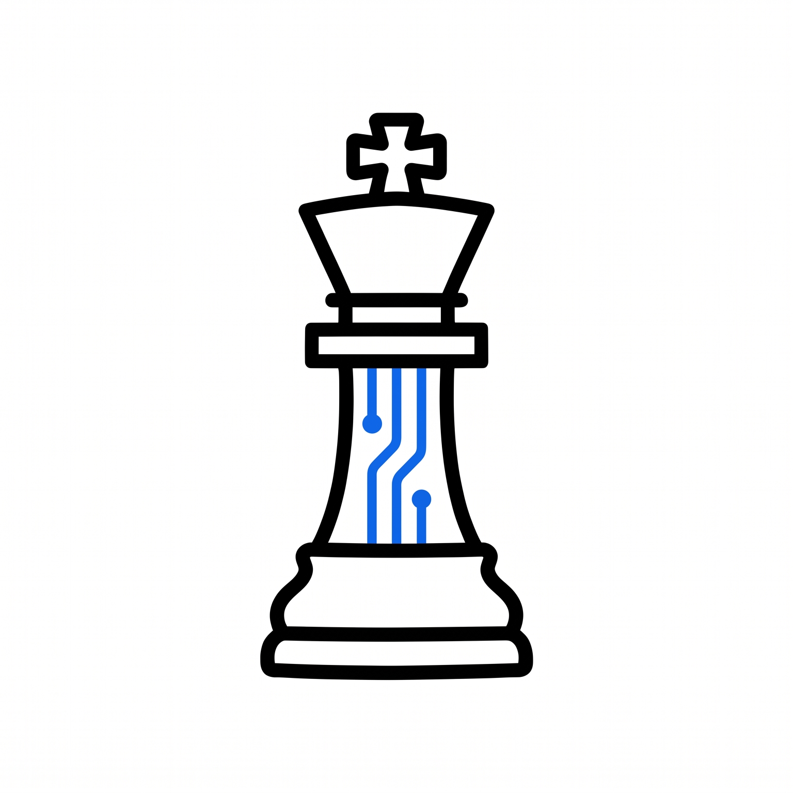
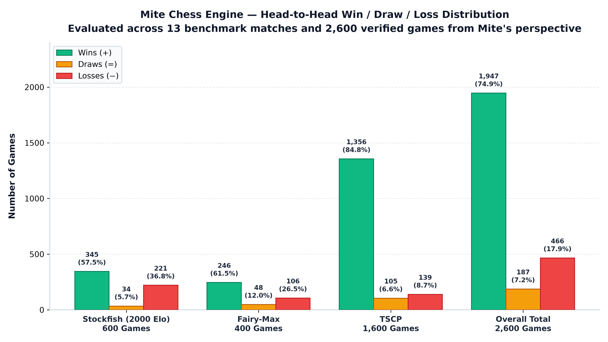

<p align="center">
  
</p>

# Mite

A compact chess engine targeting 2000-Elo-class strength in under 220 KB.

[](#benchmark-results) [](src/Mite.c) [](https://en.wikipedia.org/wiki/Universal_Chess_Interface) [](https://www.virajravani.in/mite) [](https://huggingface.co/spaces/virajravani/mite-chess)<br>
[](SECURITY.md) [](bin/Mite.exe) [](src/Mite.c) [](src/Mite.c) [](LICENSE)

**Official Website**: **[https://www.virajravani.in/mite](https://www.virajravani.in/mite)**

**Play Mite Online Now**: [Hugging Face Space](https://huggingface.co/spaces/virajravani/mite-chess)!

**Listed on**: [Computer Chess Index (CCI)](https://computer-chess-index.github.io/cci/)

---

## Table of Contents

- [Introduction](#introduction)
- [Key Features](#key-features)
- [Benchmark Results](#benchmark-results)
  - [Overall Match Summary](#overall-match-summary)
  - [Detailed Breakdown by Time Control](#detailed-breakdown-by-time-control)
  - [Color Performance](#color-performance)
- [Installation and Usage](#installation-and-usage)
  - [Play Online in the Browser](#play-online-in-the-browser)
  - [Obtaining the Executable](#obtaining-the-executable)
  - [Building from Source](#building-from-source)
  - [Using with Chess GUIs](#using-with-chess-guis)
- [Repository Structure](#repository-structure)
- [Documentation](#documentation)
- [Developer and Contact](#developer-and-contact)
- [Independence and Credits](#independence-and-credits)

---

## Introduction

**Mite** is an ultra-compact chess engine written in ANSI C by Viraj Ravani. Designed from the ground up to explore high algorithmic density, Mite demonstrates that an engine can play competitive tournament-level chess while maintaining an exceptionally small footprint.

Key characteristics include:
- **Compact Architecture**: The entire engine is implemented in a single C file (`src/Mite.c`) under 20 KB (approximately 19.7 KB across ~409 lines) and compiles to a self-contained static executable of approximately **~115 KB** on Windows (`bin/Mite.exe`), well within the target threshold of under 220 KB.
- **Universal Chess Interface (UCI)**: Full support for the standard UCI protocol enables immediate integration with graphical user interfaces (GUIs) and tournament manager tools.
- **Competitive Playing Strength**: In extensive match testing, Mite achieved winning records against reference opponents including Stockfish (calibrated to 2000 Elo limit), TSCP, and Fairy-Max. Note that playing strength claims represent experimental estimations under tested configurations and do not constitute an official certified rating list.

The repository provides the complete C source code, precompiled Windows executable, full match PGN records, benchmark data, and in-depth technical documentation.

---

## Key Features

The engine contains only algorithms and data structures verified in `src/Mite.c`:

- **Implementation Language**: Clean ANSI C (compatible with C99 and C11 standards), requiring zero external libraries or dynamic DLL dependencies.
- **Board Representation**: 0x88 board coordinate system with fast $O(1)$ off-board detection and square-difference attack ray tables.
- **Move Generation**: Pseudolegal move generation covering castling, en passant, and promotions, with rigorous legality verification.
- **Search Pipeline**:
  - Negamax formulation with Principal Variation Search (PVS).
  - Iterative deepening driver up to depth 24 plies.
  - Dynamic aspiration windowing ($[-65, +65]$ around previous score).
  - Quiescence search with Static Exchange Evaluation (SEE) pruning to resolve the horizon effect.
  - Adaptive Null-Move Pruning (NMP) with mate-threat protection.
  - Multi-condition Late Move Reductions (LMR) and Late Move Pruning (LMP).
  - Reverse futility pruning and razoring at shallow depths.
- **Move Ordering**:
  - Transposition table principal variation move scoring.
  - Most Valuable Victim – Least Valuable Attacker (MVV-LVA) and SEE capture ordering.
  - Two-tier killer move heuristics and countermove response tables.
  - Depth-squared history heuristic tables.
- **Transposition Table**:
  - Default 16 MB allocation ($2^{20}$ entries), indexed using 64-bit Zobrist hashing keys.
  - Exact, lower-bound (beta cutoff), and upper-bound (alpha cutoff) classification.
  - Generation aging and mate-distance score normalization.
- **Evaluation Engine**:
  - Handcrafted static evaluation combining material balance, packed piece-square tables, pawn structure, rook open files, king safety, knight outposts, bishop pairs, and endgame king-opposition heuristics.
- **Protocol & GUI Compatibility**: Full UCI compliance tested with Arena, Cutechess, BanksiaGUI, and tournament runners.

---

## Benchmark Results

All benchmark data is derived directly from the verified match records and PGN files in `benchmarks/` and analyzed in [`benchmarks/overview.md`](benchmarks/overview.md).

> **Disclaimer**: Match results and rating estimations are experimental outcomes from controlled automated matches under specific time controls and hardware configurations. They do not represent official CCRL, CEGT, or FIDE rating lists. Results against different engines or time controls are not directly comparable.

Score percentages are calculated from Mite's perspective using standard chess scoring:
$$\text{Score \%} = \frac{\text{Wins} + 0.5 \times \text{Draws}}{\text{Total Games}} \times 100$$

<p align="center">
  
</p>

### Overall Match Summary

Across **13 match series** and **2,600 games**, Mite recorded **zero engine crashes, zero illegal moves, and zero time forfeit losses**:

| Opponent | Match Files | Total Games | Wins (+) | Losses (−) | Draws (=) | Score % | White Record | Black Record |
| :--- | :---: | :---: | :---: | :---: | :---: | :---: | :---: | :---: |
| **TSCP** | 8 | 1,600 | 1,356 | 139 | 105 | **88.0%** | +684 −68 =48 (88.5%) | +672 −71 =57 (87.6%) |
| **Stockfish (2000 Elo limit)** | 3 | 600 | 345 | 221 | 34 | **60.3%** | +181 −99 =20 (63.7%) | +164 −122 =14 (57.0%) |
| **Fairy-Max** | 2 | 400 | 246 | 106 | 48 | **67.5%** | +136 −46 =18 (72.5%) | +110 −60 =30 (62.5%) |
| **Total / Overall** | **13** | **2,600** | **1,947** | **466** | **187** | **78.5%** | **+1,001 −213 =86 (80.3%)** | **+946 −253 =101 (76.7%)** |

### Detailed Breakdown by Time Control

Matches were conducted with alternate-color pairings (100 games as White and 100 games as Black per 200-game match).

| Opponent | Time Control | Games | Wins | Losses | Draws | Score % | White Score | Black Score | PGN File Reference |
| :--- | :--- | :---: | :---: | :---: | :---: | :---: | :---: | :---: | :--- |
| **Stockfish (2000 Elo)** | 1s / move (`tc 1`) | 200 | 107 | 82 | 11 | **56.3%** | 59.0% | 53.5% | [`benchmarks/vs_Stockfish(2000 elo)/mite_vs_stockfish2000_tc1.pgn`](benchmarks/vs_Stockfish(2000%20elo)/mite_vs_stockfish2000_tc1.pgn) |
| **Stockfish (2000 Elo)** | 5s / move (`tc 5`) | 200 | 111 | 78 | 11 | **58.3%** | 64.0% | 52.5% | [`benchmarks/vs_Stockfish(2000 elo)/mite_vs_stockfish2000_tc5.pgn`](benchmarks/vs_Stockfish(2000%20elo)/mite_vs_stockfish2000_tc5.pgn) |
| **Stockfish (2000 Elo)** | 10s / move (`tc 10`) | 200 | 127 | 61 | 12 | **66.5%** | 68.0% | 65.0% | [`benchmarks/vs_Stockfish(2000 elo)/mite_vs_stockfish2000_tc10.pgn`](benchmarks/vs_Stockfish(2000%20elo)/mite_vs_stockfish2000_tc10.pgn) |
| **Fairy-Max** | 1s / move (`tc 1`) | 200 | 123 | 55 | 22 | **67.0%** | 71.5% | 62.5% | [`benchmarks/vs_Fairy-Max/mite_vs_fairymax_tc1.pgn`](benchmarks/vs_Fairy-Max/mite_vs_fairymax_tc1.pgn) |
| **Fairy-Max** | 5s / move (`tc 5`) | 200 | 123 | 51 | 26 | **68.0%** | 73.5% | 62.5% | [`benchmarks/vs_Fairy-Max/mite_vs_fairymax_tc5.pgn`](benchmarks/vs_Fairy-Max/mite_vs_fairymax_tc5.pgn) |
| **TSCP** | 1s / move (`tc 1`) | 200 | 149 | 29 | 22 | **80.0%** | 83.0% | 77.0% | [`benchmarks/vs_TSCP/mite_vs_tscp_tc1.pgn`](benchmarks/vs_TSCP/mite_vs_tscp_tc1.pgn) |
| **TSCP** | 3s / move (`tc 3`) | 200 | 159 | 21 | 20 | **84.5%** | 87.0% | 82.0% | [`benchmarks/vs_TSCP/mite_vs_tscp_tc3.pgn`](benchmarks/vs_TSCP/mite_vs_tscp_tc3.pgn) |
| **TSCP** | 5s / move (`tc 5`) | 200 | 150 | 31 | 19 | **79.8%** | 80.0% | 79.5% | [`benchmarks/vs_TSCP/mite_vs_tscp_tc5.pgn`](benchmarks/vs_TSCP/mite_vs_tscp_tc5.pgn) |
| **TSCP** | 7s / move (`tc 7`) | 200 | 162 | 25 | 13 | **84.3%** | 83.5% | 85.0% | [`benchmarks/vs_TSCP/mite_vs_tscp_tc7.pgn`](benchmarks/vs_TSCP/mite_vs_tscp_tc7.pgn) |
| **TSCP** | 10s / move (`tc 10`) | 200 | 165 | 19 | 16 | **86.5%** | 83.5% | 89.5% | [`benchmarks/vs_TSCP/mite_vs_tscp_tc10.pgn`](benchmarks/vs_TSCP/mite_vs_tscp_tc10.pgn) |
| **TSCP** | 60s / move (`tc 60`) | 200 | 176 | 12 | 12 | **91.0%** | 92.5% | 89.5% | [`benchmarks/vs_TSCP/mite_vs_tscp_tc60.pgn`](benchmarks/vs_TSCP/mite_vs_tscp_tc60.pgn) |
| **TSCP** | Fixed 0.5s (`st 0.5`) | 200 | 198 | 1 | 1 | **99.3%** | 100.0% | 98.5% | [`benchmarks/vs_TSCP/mite_vs_tscp_st0.5.pgn`](benchmarks/vs_TSCP/mite_vs_tscp_st0.5.pgn) |
| **TSCP** | Fixed 2.0s (`st 2`) | 200 | 197 | 1 | 2 | **99.0%** | 98.5% | 99.5% | [`benchmarks/vs_TSCP/mite_vs_tscp_st2.pgn`](benchmarks/vs_TSCP/mite_vs_tscp_st2.pgn) |

### Color Performance

Evaluating play as White versus Black across all 2,600 games:

- **Mite as White (1,300 Games)**: 1,001 Wins (77.0%), 213 Losses (16.4%), 86 Draws (6.6%) — **80.3% Score**
- **Mite as Black (1,300 Games)**: 946 Wins (72.8%), 253 Losses (19.5%), 101 Draws (7.8%) — **76.7% Score**
- **Color Bias**: White maintains a modest +3.6% score advantage overall. Against TSCP, performance was nearly symmetric (88.5% White vs. 87.6% Black, a difference of under 1%).

For in-depth termination breakdowns and statistical observations, refer to [`benchmarks/overview.md`](benchmarks/overview.md).

---

## Installation and Usage

### Play Online in the Browser

Play against Mite instantly in any desktop, laptop, or mobile browser with zero installation:

 **[https://huggingface.co/spaces/virajravani/mite-chess](https://huggingface.co/spaces/virajravani/mite-chess)**

- **Genuine Engine**: Powered by Mite compiled directly to WebAssembly (`engine/mite.wasm`, ~60 KB) running in a dedicated Web Worker (~800,000–1,500,000 nodes/sec).
- **Responsive Design**: Adapts cleanly across mobile phones, tablets, laptops, and wide screens.
- **Complete Rules & Timing**: Supports Bullet (1+0, 1+1), Blitz (3+0, 3+2, 5+0, 5+3), Rapid (10+0, 10+5, 15+10), custom and casual formats, captured piece trays with material difference calculation, max 3 undos per match, board flip, and synthesized audio.

### Obtaining the Executable

A precompiled 64-bit Windows binary is located at:
```
bin/Mite.exe
```
This executable is completely standalone (~115 KB) and requires no runtime DLL installations.

### Building from Source

#### Using Make (Recommended)
Mite includes a portable Makefile configured for GCC/MinGW on Windows and POSIX:
```bash
mingw32-make
```
To remove the compiled binary:
```bash
mingw32-make clean
```
To view available targets and variables:
```bash
mingw32-make help
```

#### Manual Compilation
Compile directly with any standard C compiler:

**GCC (MinGW / Linux):**
```bash
gcc -O3 -fomit-frame-pointer src/Mite.c -o bin/Mite.exe
```

**Clang / LLVM:**
```bash
clang -O3 -flto src/Mite.c -o bin/Mite.exe
```

**Microsoft Visual C++ (MSVC):**
```cmd
cl /O2 /Oi /Ot /GS- src\Mite.c /Fe:bin\Mite.exe
```

For complete prerequisites, tool installation, and build configuration, refer to [`SETUP.md`](SETUP.md).

### Using with Chess GUIs

Mite is a pure UCI engine communicating over standard input and output (`stdin` / `stdout`). It is designed to be loaded into a UCI-compatible chess graphical user interface:

1. **Arena**: Go to `Engines` → `Install New Engine...` → select `bin/Mite.exe` → choose `UCI`.
2. **Cutechess**: Go to `Tools` → `Settings` → `Engines` → `+` → select `bin/Mite.exe` (protocol will auto-detect as `uci`).
3. **BanksiaGUI**: Go to `Engines` → `Manage Engines` → `Add` → select `bin/Mite.exe`.
4. **Fritz / ChessBase**: Go to `Engine` → `Create UCI Engine` → browse to `bin/Mite.exe`.

#### Automated Match Testing via Cutechess-CLI
```bash
cutechess-cli -engine cmd=bin/Mite.exe name=Mite proto=uci \
              -engine cmd=opponent.exe proto=uci \
              -each tc=10+0.1 -rounds 200 -repeat -recover \
              -pgnout match.pgn
```

> **Note**: Mite does not feature an interactive command-line board interface. Launching `bin/Mite.exe` directly in a terminal opens the standard UCI listener (you can type commands like `uci`, `isready`, `position startpos`, and `go depth 6`).

---

## Repository Structure

The actual verified directory layout of the repository is as follows:

```
chessengine/
├── assets/
│   ├── benchmark_results.png          # Head-to-head win/draw/loss graph
│   ├── color_performance.png          # White vs. Black performance graph
│   ├── draw_distribution.png          # Decisiveness and draw breakdown graph
│   ├── mite_logo.png                  # Project logo artwork
│   ├── score_by_opponent.png          # Match score percentage graph
│   └── time_control_comparison.png    # Time control scaling graph
├── benchmarks/
│   ├── vs_Fairy-Max/                  # Match PGN archives vs Fairy-Max (tc 1, tc 5)
│   ├── vs_Stockfish(2000 elo)/        # Match PGN archives vs Stockfish 2000 (tc 1, tc 5, tc 10)
│   ├── vs_TSCP/                       # Match PGN archives vs TSCP (tc 1 to 60, st 0.5, st 2)
│   └── overview.md                    # Comprehensive match benchmarks & performance analysis
├── bin/
│   └── Mite.exe                       # Precompiled Windows static executable (~115 KB)
├── huggingface/                       # Complete Hugging Face Static Space web application
│   ├── assets/                        # 12 real PNG chess pieces and optimized branding
│   ├── build/                         # WebAssembly compilation scripts (build.bat, build.sh)
│   ├── engine/                        # WebAssembly source (mite.c), loader (mite.js), binary (mite.wasm)
│   ├── scripts/                       # Web Worker, chess rules, game coordinator, UI controller
│   ├── styles/                        # Responsive tournament dark theme stylesheet
│   ├── index.html                     # Web application entry point
│   ├── README.md                      # Hugging Face Space configuration (sdk: static)
│   └── SETUP.md                       # Space compilation, testing, and deployment guide
├── src/
│   └── Mite.c                         # Monolithic engine C source code (< 20 KB)
├── CONTRIBUTING.md                    # Guidelines for contributing and reporting issues
├── DISCLAIMER.md                      # Legal disclaimers and trademark acknowledgments
├── ENGINE_NOTES.md                    # Exhaustive technical documentation (> 2,200 lines)
├── LICENSE                            # MIT License open-source terms
├── Makefile                           # Portable build automation script for GCC/MinGW
├── README.md                          # Project documentation and quick start guide
├── SECURITY.md                        # Security policy and vulnerability disclosure procedures
└── SETUP.md                           # Setup, compilation, and automated match testing guide
```

### Directory & File Roles
- **`assets/`**: Visual assets including the engine logo and high-resolution benchmark performance charts.
- **`benchmarks/`**: The complete raw PGN match records across all 2,600 benchmark tournament games organized by opponent folder, along with the detailed statistical overview (`overview.md`).
- **`bin/`**: Ready-to-run precompiled engine binaries.
- **`huggingface/`**: Standalone WebAssembly static web deployment hosted on Hugging Face Spaces for free in-browser play across desktop and mobile devices.
- **`src/`**: Primary engine C source code.
- **`Makefile`**: Configurable build automation script.
- **`LICENSE`**: Open-source license terms (MIT).
- **`SETUP.md`**: Guide for compiling, running, and match testing.
- **`ENGINE_NOTES.md`**: Architectural manual detailing every global variable, function, macro, and search heuristic.

---

## Documentation

For specialized documentation and contributor policies, consult the dedicated repository files:

- [`ENGINE_NOTES.md`](ENGINE_NOTES.md) — Comprehensive technical reference detailing 0x88 geometry, move generation, evaluation terms, search heuristics, and UCI protocol loops (over 2,200 lines).
- [`SETUP.md`](SETUP.md) — Setup guide covering prerequisites, Makefile usage, Cute Chess CLI match commands, and troubleshooting.
- [`benchmarks/overview.md`](benchmarks/overview.md) — Exhaustive match results report, termination distributions, and head-to-head performance statistics.
- [`CONTRIBUTING.md`](CONTRIBUTING.md) — Guidelines for reporting bugs, submitting code changes, and running benchmarks.
- [`SECURITY.md`](SECURITY.md) — Vulnerability reporting policy and maintainer contact instructions.
- [`DISCLAIMER.md`](DISCLAIMER.md) — Third-party trademark notices, experimental rating clarifications, and "as-is" software warranty terms.
- [`LICENSE`](LICENSE) — Open-source terms and permissions under the MIT License.

---

## Developer and Contact

Developed by **[Viraj Ravani](https://virajravani.in/)**.

- **Official Website**: [https://www.virajravani.in/mite](https://www.virajravani.in/mite)
- **Email**: [viraj.ravani@somaiya.edu](mailto:viraj.ravani@somaiya.edu)
- **LinkedIn**: [linkedin.com/in/virajravani](https://www.linkedin.com/in/virajravani/)

---

## Independence and Credits

Mite is an independent open-source project. Third-party product names and trademarks mentioned in this repository—including **Stockfish**, **TSCP**, **Fairy-Max**, and related software—belong exclusively to their respective authors and project maintainers. Reference to these engines does not imply affiliation, sponsorship, or endorsement.

For additional legal boundaries and attribution details, please review [`DISCLAIMER.md`](DISCLAIMER.md).
