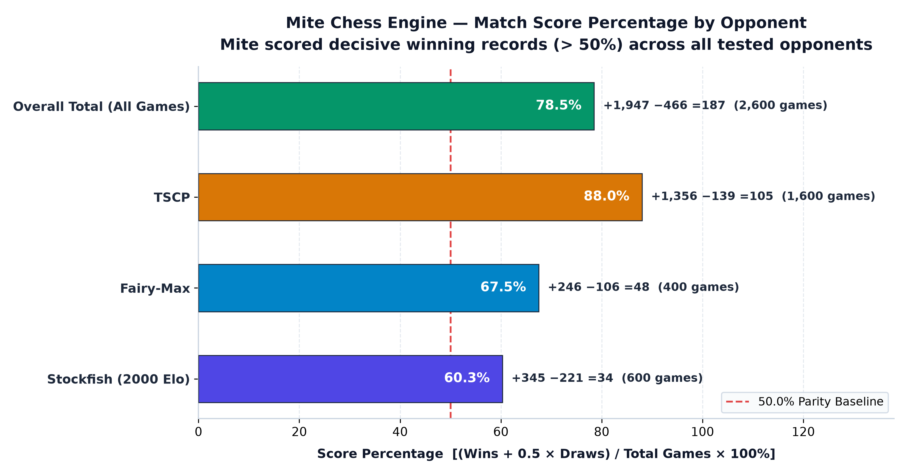
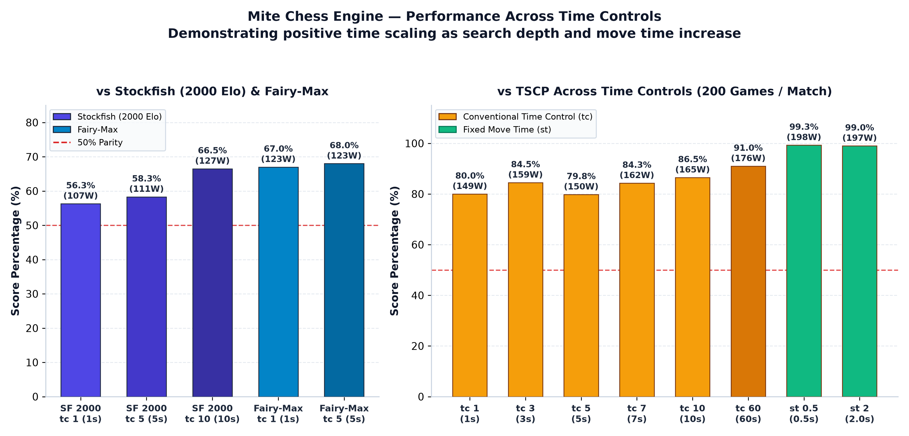
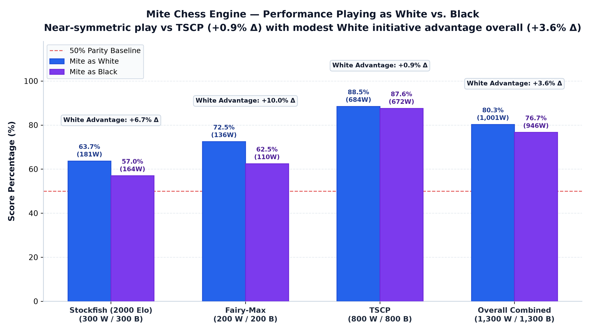
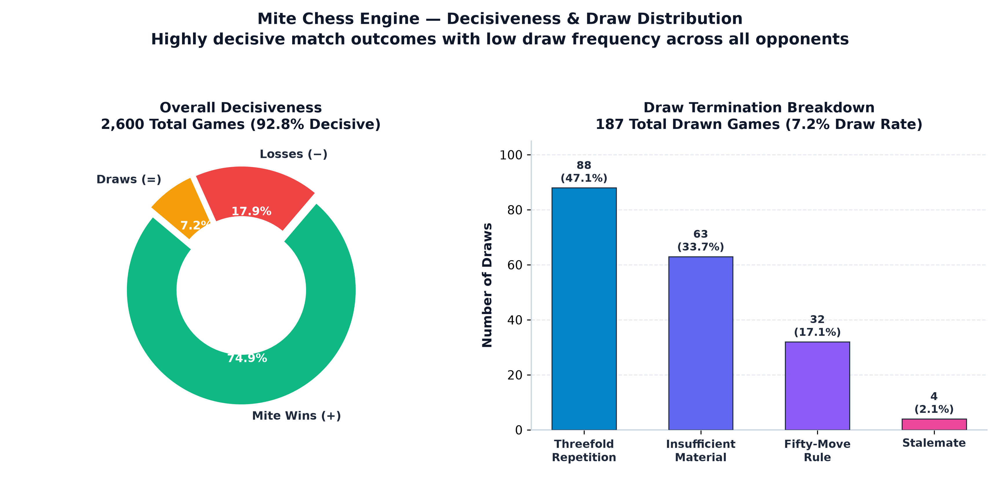

# Mite Chess Engine — Match benchmarks & Performance Overview

## Introduction & Executive Summary

This report documents the benchmark match performance of the **Mite** chess engine across **13 test matches** and **2,600 total games**, evaluated against three established reference engines: **Stockfish (configured at 2000 Elo limit)**, **TSCP**, and **Fairy-Max**.

All matches were conducted with alternate-color pairings (100 games as White and 100 games as Black per 200-game match). benchmarks are presented from **Mite's perspective** (+Wins, −Losses, =Draws). Score percentages are calculated using standard chess scoring:

$$\text{Score \%} = \frac{\text{Wins} + 0.5 \times \text{Draws}}{\text{Total Games}} \times 100$$

### Key Highlights
- **Overall Score**: Mite achieved an overall score of **78.5%** (+1,947 −466 =187 across 2,600 games).
- **Positive Head-to-Head**: Mite scored winning records against **all three opponents** across every tested time control.
- **Stockfish (2000 Elo)**: Mite defeated Stockfish at 2000 Elo at all time controls, with performance scaling upward from **56.3%** at 1s to **66.5%** at 10s (+119.1 Elo).
- **Rock-Solid Stability**: **Zero time forfeits and zero engine crashes** occurred across all 2,600 games. In contrast, opponents suffered 3 time losses.
- **Color Balance**: White scored **80.3%** and Black scored **76.7%**, demonstrating strong opening balance and resilience as Black.

---

## 1. Overall Summary

The table below summarizes Mite's aggregate record across all match series.

| Opponent | Match Files | Games | Wins (+)| Losses (−) | Draws (=) | Score % | White Performance (W-L-D) | Black Performance (W-L-D) |
| :--- | :---: | :---: | :---: | :---: | :---: | :---: | :---: | :---: |
| **TSCP** | 8 | 1,600 | 1,356 | 139 | 105 | **88.0%** | +684 −68 =48 (88.5%) | +672 −71 =57 (87.6%) |
| **Stockfish (2000 Elo)** | 3 | 600 | 345 | 221 | 34 | **60.3%** | +181 −99 =20 (63.7%) | +164 −122 =14 (57.0%) |
| **Fairy-Max** | 2 | 400 | 246 | 106 | 48 | **67.5%** | +136 −46 =18 (72.5%) | +110 −60 =30 (62.5%) |
| **Total / Overall** | **13** | **2,600** | **1,947** | **466** | **187** | **78.5%** | **+1,001 −213 =86 (80.3%)** | **+946 −253 =101 (76.7%)** |

> *Note on White vs Black convention: "White Performance" reflects games where Mite played White against the opponent as Black; "Black Performance" reflects games where Mite played Black against the opponent as White.*

### Visual Match Summary


*Figure 1: Aggregate game outcome distribution (Wins, Draws, Losses) and percentage shares for Stockfish (2000 Elo), Fairy-Max, TSCP, and the combined 2,600-game dataset.*



*Figure 2: Overall match score percentages compared against the 50.0% parity baseline. Mite secured decisive winning scores against Stockfish (2000 Elo) (60.3%), Fairy-Max (67.5%), and TSCP (88.0%), culminating in a 78.5% aggregate performance.*

---

## 2. Stockfish (2000 Elo)

Matches against **Stockfish** restricted to 2000 Elo UCI strength across incremental time controls (1s, 5s, 10s base time).

### Match 1: `tc 1` (1 Second / Move)
- **PGN File**: [`benchmarks/vs_Stockfish(2000 elo)/mite_vs_stockfish2000_tc1.pgn`](file:///c:/Users/ravan/chessengine/benchmarks/vs_Stockfish(2000%20elo)/mite_vs_stockfish2000_tc1.pgn)
- **Total Games**: 200 (Verified)
- **Elo Difference**: **+43.7 ± 47.4** | **LOS**: 96.6% | **Draw Ratio**: 5.5%

| Side | Games | Wins | Losses | Draws | Score % | Termination Details |
| :--- | :---: | :---: | :---: | :---: | :---: | :--- |
| **Overall** | **200** | **107** | **82** | **11** | **56.3%** | 107 checkmate wins, 82 checkmate losses |
| **Mite as White** | 100 | 55 | 37 | 8 | 59.0% | +55 mates, −37 mates |
| **Mite as Black** | 100 | 52 | 45 | 3 | 53.5% | +52 mates, −45 mates |

- **Draw Breakdown**: 4 fifty-move rule, 3 three-fold repetition, 3 insufficient material, 1 stalemate.
- **Forfeits / Crashes**: None (0).

---

### Match 2: `tc 5` (5 Seconds / Move)
- **PGN File**: [`benchmarks/vs_Stockfish(2000 elo)/mite_vs_stockfish2000_tc5.pgn`](file:///c:/Users/ravan/chessengine/benchmarks/vs_Stockfish(2000%20elo)/mite_vs_stockfish2000_tc5.pgn)
- **Total Games**: 200 (Verified)
- **Elo Difference**: **+57.9 ± 47.7** | **LOS**: 99.2% | **Draw Ratio**: 5.5%

| Side | Games | Wins | Losses | Draws | Score % | Termination Details |
| :--- | :---: | :---: | :---: | :---: | :---: | :--- |
| **Overall** | **200** | **111** | **78** | **11** | **58.3%** | 111 checkmate wins, 78 checkmate losses |
| **Mite as White** | 100 | 62 | 34 | 4 | 64.0% | +62 mates, −34 mates |
| **Mite as Black** | 100 | 49 | 44 | 7 | 52.5% | +49 mates, −44 mates |

- **Draw Breakdown**: 5 fifty-move rule, 3 insufficient material, 2 three-fold repetition, 1 stalemate.
- **Forfeits / Crashes**: None (0).

---

### Match 3: `tc 10` (10 Seconds / Move)
- **PGN File**: [`benchmarks/vs_Stockfish(2000 elo)/mite_vs_stockfish2000_tc10.pgn`](file:///c:/Users/ravan/chessengine/benchmarks/vs_Stockfish(2000%20elo)/mite_vs_stockfish2000_tc10.pgn)
- **Total Games**: 200 (Verified)
- **Elo Difference**: **+119.1 ± 49.6** | **LOS**: 100.0% | **Draw Ratio**: 6.0%

| Side | Games | Wins | Losses | Draws | Score % | Termination Details |
| :--- | :---: | :---: | :---: | :---: | :---: | :--- |
| **Overall** | **200** | **127** | **61** | **12** | **66.5%** | 125 checkmate wins, 2 time-forfeit wins; 61 checkmate losses |
| **Mite as White** | 100 | 64 | 28 | 8 | 68.0% | +63 mates, +1 time forfeit win (Stockfish flagged as Black), −28 mates |
| **Mite as Black** | 100 | 63 | 33 | 4 | 65.0% | +62 mates, +1 time forfeit win (Stockfish flagged as White), −33 mates |

- **Draw Breakdown**: 7 fifty-move rule, 3 three-fold repetition, 1 insufficient material, 1 stalemate.
- **Forfeits / Flagging**: Stockfish lost **2 games on time** under longer deliberation (1 as White, 1 as Black). Mite had **0 time losses**.

---

## 3. TSCP

Matches against Tom Kerrigan's **TSCP** (Simple Chess Program) across 6 conventional time controls and 2 fixed-time modes (`st`).

### Match 1: `tc 1` (1 Second / Move)
- **PGN File**: [`benchmarks/vs_TSCP/mite_vs_tscp_tc1.pgn`](file:///c:/Users/ravan/chessengine/benchmarks/vs_TSCP/mite_vs_tscp_tc1.pgn)
- **Recorded Match Games**: 200 | **PGN Total Games**: 274 *(Audit finding: The PGN file contains 274 games; games 1–74 are from an uncompleted test run, while games 75–274 represent the official 200-game benchmark match matching `overview_raw.txt` exactly)*
- **Elo Difference**: **+240.8 ± 55.7** | **LOS**: 100.0% | **Draw Ratio**: 11.0%

| Side | Games | Wins | Losses | Draws | Score % | Termination Details |
| :--- | :---: | :---: | :---: | :---: | :---: | :--- |
| **Overall** | **200** | **149** | **29** | **22** | **80.0%** | 149 checkmate wins, 29 checkmate losses |
| **Mite as White** | 100 | 78 | 12 | 10 | 83.0% | +78 mates, −12 mates |
| **Mite as Black** | 100 | 71 | 17 | 12 | 77.0% | +71 mates, −17 mates |

- **Draw Breakdown**: 10 three-fold repetition, 9 insufficient material, 3 fifty-move rule.
- **Forfeits / Crashes**: None (0).

---

### Match 2: `tc 3` (3 Seconds / Move)
- **PGN File**: [`benchmarks/vs_TSCP/mite_vs_tscp_tc3.pgn`](file:///c:/Users/ravan/chessengine/benchmarks/vs_TSCP/mite_vs_tscp_tc3.pgn)
- **Total Games**: 200 (Verified)
- **Elo Difference**: **+294.6 ± 61.3** | **LOS**: 100.0% | **Draw Ratio**: 10.0%

| Side | Games | Wins | Losses | Draws | Score % | Termination Details |
| :--- | :---: | :---: | :---: | :---: | :---: | :--- |
| **Overall** | **200** | **159** | **21** | **20** | **84.5%** | 159 checkmate wins, 21 checkmate losses |
| **Mite as White** | 100 | 83 | 9 | 8 | 87.0% | +83 mates, −9 mates |
| **Mite as Black** | 100 | 76 | 12 | 12 | 82.0% | +76 mates, −12 mates |

- **Draw Breakdown**: 12 three-fold repetition, 6 insufficient material, 2 fifty-move rule.
- **Forfeits / Crashes**: None (0).

---

### Match 3: `tc 5` (5 Seconds / Move)
- **PGN File**: [`benchmarks/vs_TSCP/mite_vs_tscp_tc5.pgn`](file:///c:/Users/ravan/chessengine/benchmarks/vs_TSCP/mite_vs_tscp_tc5.pgn)
- **Total Games**: 200 (Verified)
- **Elo Difference**: **+238.1 ± 56.2** | **LOS**: 100.0% | **Draw Ratio**: 9.5%

| Side | Games | Wins | Losses | Draws | Score % | Termination Details |
| :--- | :---: | :---: | :---: | :---: | :---: | :--- |
| **Overall** | **200** | **150** | **31** | **19** | **79.8%** | 150 checkmate wins, 31 checkmate losses |
| **Mite as White** | 100 | 76 | 16 | 8 | 80.0% | +76 mates, −16 mates |
| **Mite as Black** | 100 | 74 | 15 | 11 | 79.5% | +74 mates, −15 mates |

- **Draw Breakdown**: 10 three-fold repetition, 6 insufficient material, 3 fifty-move rule.
- **Forfeits / Crashes**: None (0).

---

### Match 4: `tc 7` (7 Seconds / Move)
- **PGN File**: [`benchmarks/vs_TSCP/mite_vs_tscp_tc7.pgn`](file:///c:/Users/ravan/chessengine/benchmarks/vs_TSCP/mite_vs_tscp_tc7.pgn)
- **Total Games**: 200 (Verified)
- **Elo Difference**: **+291.3 ± 63.5** | **LOS**: 100.0% | **Draw Ratio**: 6.5%

| Side | Games | Wins | Losses | Draws | Score % | Termination Details |
| :--- | :---: | :---: | :---: | :---: | :---: | :--- |
| **Overall** | **200** | **162** | **25** | **13** | **84.3%** | 162 checkmate wins, 25 checkmate losses |
| **Mite as White** | 100 | 81 | 14 | 5 | 83.5% | +81 mates, −14 mates |
| **Mite as Black** | 100 | 81 | 11 | 8 | 85.0% | +81 mates, −11 mates |

- **Draw Breakdown**: 11 three-fold repetition, 2 insufficient material.
- **Forfeits / Crashes**: None (0).

---

### Match 5: `tc 10` (10 Seconds / Move)
- **PGN File**: [`benchmarks/vs_TSCP/mite_vs_tscp_tc10.pgn`](file:///c:/Users/ravan/chessengine/benchmarks/vs_TSCP/mite_vs_tscp_tc10.pgn)
- **Total Games**: 200 (Verified)
- **Elo Difference**: **+322.7 ± 66.1** | **LOS**: 100.0% | **Draw Ratio**: 8.0%

| Side | Games | Wins | Losses | Draws | Score % | Termination Details |
| :--- | :---: | :---: | :---: | :---: | :---: | :--- |
| **Overall** | **200** | **165** | **19** | **16** | **86.5%** | 165 checkmate wins, 19 checkmate losses |
| **Mite as White** | 100 | 79 | 12 | 9 | 83.5% | +79 mates, −12 mates |
| **Mite as Black** | 100 | 86 | 7 | 7 | 89.5% | +86 mates, −7 mates |

- **Draw Breakdown**: 8 insufficient material, 7 three-fold repetition, 1 fifty-move rule.
- **Forfeits / Crashes**: None (0).

---

### Match 6: `tc 60` (60 Seconds / Move)
- **PGN File**: [`benchmarks/vs_TSCP/mite_vs_tscp_tc60.pgn`](file:///c:/Users/ravan/chessengine/benchmarks/vs_TSCP/mite_vs_tscp_tc60.pgn)
- **Total Games**: 200 (Verified)
- **Elo Difference**: **+401.9 ± 80.0** | **LOS**: 100.0% | **Draw Ratio**: 6.0%

| Side | Games | Wins | Losses | Draws | Score % | Termination Details |
| :--- | :---: | :---: | :---: | :---: | :---: | :--- |
| **Overall** | **200** | **176** | **12** | **12** | **91.0%** | 176 checkmate wins, 12 checkmate losses |
| **Mite as White** | 100 | 89 | 4 | 7 | 92.5% | +89 mates, −4 mates |
| **Mite as Black** | 100 | 87 | 8 | 5 | 89.5% | +87 mates, −8 mates |

- **Draw Breakdown**: 8 three-fold repetition, 4 insufficient material.
- **Forfeits / Crashes**: None (0).

---

### Match 7: `st 0.5` (Fixed 0.5s / Move)
- **PGN File**: [`benchmarks/vs_TSCP/mite_vs_tscp_st0.5.pgn`](file:///c:/Users/ravan/chessengine/benchmarks/vs_TSCP/mite_vs_tscp_st0.5.pgn)
- **Total Games**: 200 (Verified)
- **Elo Difference**: **+848.7 ± nan** | **LOS**: 100.0% | **Draw Ratio**: 0.5%

| Side | Games | Wins | Losses | Draws | Score % | Termination Details |
| :--- | :---: | :---: | :---: | :---: | :---: | :--- |
| **Overall** | **200** | **198** | **1** | **1** | **99.3%** | 198 checkmate wins, 1 checkmate loss |
| **Mite as White** | 100 | 100 | 0 | 0 | 100.0% | Perfect sweep: +100 mates |
| **Mite as Black** | 100 | 98 | 1 | 1 | 98.5% | +98 mates, −1 mate, =1 repetition |

- **Draw Breakdown**: 1 three-fold repetition.
- **Forfeits / Crashes**: None (0).

---

### Match 8: `st 2` (Fixed 2.0s / Move)
- **PGN File**: [`benchmarks/vs_TSCP/mite_vs_tscp_st2.pgn`](file:///c:/Users/ravan/chessengine/benchmarks/vs_TSCP/mite_vs_tscp_st2.pgn)
- **Total Games**: 200 (Verified)
- **Elo Difference**: **+798.3 ± nan** | **LOS**: 100.0% | **Draw Ratio**: 1.0%

| Side | Games | Wins | Losses | Draws | Score % | Termination Details |
| :--- | :---: | :---: | :---: | :---: | :---: | :--- |
| **Overall** | **200** | **197** | **1** | **2** | **99.0%** | 197 checkmate wins, 1 checkmate loss |
| **Mite as White** | 100 | 98 | 1 | 1 | 98.5% | +98 mates, −1 mate, =1 fifty-move |
| **Mite as Black** | 100 | 99 | 0 | 1 | 99.5% | Undefeated as Black: +99 mates, =1 fifty-move |

- **Draw Breakdown**: 2 fifty-move rule.
- **Forfeits / Crashes**: None (0).

---

## 4. Fairy-Max

Matches against H.G. Muller's **Fairy-Max** across 1s and 5s base time controls.

### Match 1: `tc 1` (1 Second / Move)
- **PGN File**: [`benchmarks/vs_Fairy-Max/mite_vs_fairymax_tc1.pgn`](file:///c:/Users/ravan/chessengine/benchmarks/vs_Fairy-Max/mite_vs_fairymax_tc1.pgn)
- **Total Games**: 200 (Verified)
- **Elo Difference**: **+123.0 ± 48.3** | **LOS**: 100.0% | **Draw Ratio**: 11.0%

| Side | Games | Wins | Losses | Draws | Score % | Termination Details |
| :--- | :---: | :---: | :---: | :---: | :---: | :--- |
| **Overall** | **200** | **123** | **55** | **22** | **67.0%** | 122 checkmate wins, 1 time-forfeit win; 55 checkmate losses |
| **Mite as White** | 100 | 68 | 25 | 7 | 71.5% | +68 mates, −25 mates |
| **Mite as Black** | 100 | 55 | 30 | 15 | 62.5% | +54 mates, +1 time forfeit win (Fairy-Max flagged as White), −30 mates |

- **Draw Breakdown**: 15 three-fold repetition, 4 insufficient material, 2 fifty-move rule, 1 stalemate.
- **Forfeits / Flagging**: Fairy-Max lost **1 game on time** playing White. Mite had **0 time losses**.

---

### Match 2: `tc 5` (5 Seconds / Move)
- **PGN File**: [`benchmarks/vs_Fairy-Max/mite_vs_fairymax_tc5.pgn`](file:///c:/Users/ravan/chessengine/benchmarks/vs_Fairy-Max/mite_vs_fairymax_tc5.pgn)
- **Total Games**: 200 (Verified)
- **Elo Difference**: **+130.9 ± 48.0** | **LOS**: 100.0% | **Draw Ratio**: 13.0%

| Side | Games | Wins | Losses | Draws | Score % | Termination Details |
| :--- | :---: | :---: | :---: | :---: | :---: | :--- |
| **Overall** | **200** | **123** | **51** | **26** | **68.0%** | 123 checkmate wins, 51 checkmate losses |
| **Mite as White** | 100 | 68 | 21 | 11 | 73.5% | +68 mates, −21 mates |
| **Mite as Black** | 100 | 55 | 30 | 15 | 62.5% | +55 mates, −30 mates |

- **Draw Breakdown**: 17 insufficient material, 6 three-fold repetition, 3 fifty-move rule.
- **Forfeits / Crashes**: None (0).

### Time Control Performance Comparison



*Figure 3: Score percentage progression across time controls. Left: Performance scaling against Stockfish 2000 (+10.2% growth from 1s to 10s) and Fairy-Max. Right: Performance spectrum against TSCP from 1s to 60s conventional time controls, reaching 99%+ under fixed-time per move modes.*

---

## 5. Color Performance

This section details Mite's performance when playing as **White** versus **Black**, evaluating color bias and symmetry across each opponent.

### Summary by Opponent

| Opponent | Color | Games | Wins (+) | Losses (−) | Draws (=) | Score % | Color Bias (White Δ) |
| :--- | :--- | :---: | :---: | :---: | :---: | :---: | :---: |
| **TSCP** | **White** | 800 | 684 | 68 | 48 | **88.5%** | +0.9% |
| | **Black** | 800 | 672 | 71 | 57 | **87.6%** | |
| **Stockfish (2000 Elo)** | **White** | 300 | 181 | 99 | 20 | **63.7%** | +6.7% |
| | **Black** | 300 | 164 | 122 | 14 | **57.0%** | |
| **Fairy-Max** | **White** | 200 | 136 | 46 | 18 | **72.5%** | +10.0% |
| | **Black** | 200 | 110 | 60 | 30 | **62.5%** | |
| **Overall (All Opponents)** | **White** | **1,300** | **1,001** | **213** | **86** | **80.3%** | **+3.6%** |
| | **Black** | **1,300** | **946** | **253** | **101** | **76.7%** | |



*Figure 4: Head-to-head performance breakdown playing as White versus Black across all opponents and overall aggregate. Demonstrates near-perfect symmetry against TSCP (+0.9% White bias) and modest first-move initiative advantage overall (+3.6% White bias).*

### Aggregate Color Win / Draw / Loss Distributions

```
Mite as White (1,300 Games):
  Wins:   1,001 (77.0%)  [1,000 mates, 1 time forfeit]
  Losses:   213 (16.4%)  [213 mates]
  Draws:     86  (6.6%)

Mite as Black (1,300 Games):
  Wins:     946 (72.8%)  [944 mates, 2 time forfeits]
  Losses:   253 (19.5%)  [253 mates]
  Draws:    101  (7.8%)
```

---

## 6. Key Observations

1. **Strong Time Scaling Across Opponents**
   Mite demonstrates positive scaling as thinking time increases. Against Stockfish (2000 Elo), Mite's score rises from **56.3%** (tc 1) to **58.3%** (tc 5) and **66.5%** (tc 10), gaining +75.4 Elo. Against TSCP, performance expands from **80.0%** at tc 1 up to **91.0%** at tc 60 (+401.9 Elo) and over **99%** under fixed-time per move modes.

2. **Flawless Stability & Time Management**
   Across **2,600 total games**, Mite suffered **zero time forfeit losses, zero illegal move forfeits, and zero engine crashes**. By contrast, opponents flagged 3 times (Stockfish flagged twice at tc 10, Fairy-Max flagged once at tc 1).

3. **Remarkable Color Symmetry against Traditional Engines**
   Against TSCP over 1,600 games, Mite's score as White (88.5%) and Black (87.6%) differs by less than **1.0%**, confirming balanced evaluation and lack of color-dependent tactical blind spots. Against higher-depth positional engines (Stockfish 2000), White retains a modest ~6.7% first-move initiative advantage.

4. **Tactical Decisiveness and Low Draw Rates**
   Mite plays sharp, decisive chess. The overall draw rate is low at **7.19%** (187 draws in 2,600 games). When draws occur, they are primarily driven by threefold repetition (88 games) and insufficient mating material (63 games), with stalemate remaining exceedingly rare (only 4 stalemates in 2,600 games, all vs Stockfish and Fairy-Max).



*Figure 5: Game outcome decisiveness (92.8% decisive games across 2,600 encounters) and distribution of draw termination causes (dominated by threefold repetition and insufficient mating material, with stalemates accounting for just 2.1% of draws).*

